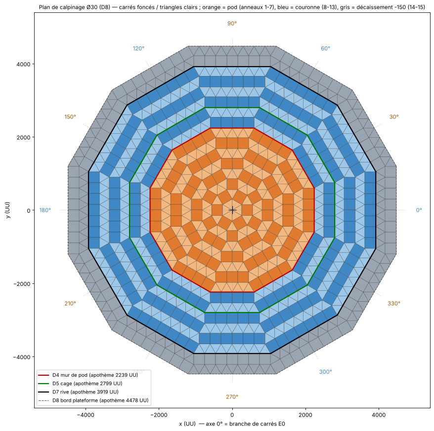

# Module 01 — Sol et nivellement (calpinage Ø30, bord abaissé en 2 paliers)

Templates :
- `templates/phases/P1.json` : sol complet (anneaux 1 à 15) avec la pile d'ancrage ;
- `templates/01b_sol_extension_D4_D8.json` : anneaux 8 à 15 seulement, pour une étoile déjà posée.

Coordonnées pièce par pièce : `donnees/01_sol_D8_complet.csv`, `donnees/01b_sol_extension_D4_D8.csv`.
Plan : `plans/plan_calpinage.png`.

## 1. Principe : l'étoile dodécagonale à branches radiales

Le tracé en étoile existant n'est pas un quadrillage tourné. C'est une **croissance par anneaux** autour d'un hexagone central, où alternent des **rangées de carrés** (les branches radiales) et des **trapèzes de triangles**. Après chaque paire d'anneaux, le contour redevient un dodécagone régulier D(n) de côté n fondations. Tous les angles valent 60°, 90°, 120° ou 150°, ce qui permet de **tout poser avec les accroches vanilla** carré/triangle d'ASA.

La règle est simple. On numérote les 12 côtés par leur normale θ = 0°, 30°, 60°… :
- **E0** = côtés à 0°, 60°, 120°, 180°, 240°, 300° ;
- **E1** = côtés à 30°, 90°, 150°, 210°, 270°, 330°.

| Anneau | Sur les côtés « carrés » | Sur les autres côtés |
|---|---|---|
| **impair** (1, 3, 5…) | E0 : une rangée de `(r+1)/2` carrés collés au côté | E1 : un trapèze de base `(r−1)/2`, soit `(r−1)/2` triangles pointe vers l'extérieur posés sur le côté + `(r+1)/2` triangles pointe vers l'intérieur intercalés |
| **pair** (2, 4, 6…) | E1 : une rangée de `r/2` carrés | E0 : un trapèze de base `r/2`, soit `r/2` triangles pointe vers l'extérieur + `r/2 + 1` triangles pointe vers l'intérieur |

Aux 12 coins, le dernier carré d'une rangée et le triangle d'extrémité du trapèze voisin partagent une arête : la pièce suivante s'accroche toujours à une arête déjà posée.

**Alignement.** Les anneaux 1 à 7 générés par cette règle sont identiques au template SkunkHD n° 481 (*Large.Cliff.Plat.Base*) : 96 carrés + 186 triangles retrouvés à moins de 1 UU, orientation comprise (`python3 outils/forteresse.py --verifier-481 …`). Le centre et l'axe 0° du projet sont donc ceux du tracé existant.

## 2. Tableau des anneaux

Les apothèmes sont mesurés depuis le centre jusqu'au contour extérieur de l'anneau, le long des normales E0 et E1.

| Anneau | Carrés sur | Carrés | Triangles (ext. / int.) | Pièces par côté E0 / E1 après l'anneau | Apothème E0 / E1 (UU) | Zone | Z plan |
|---|---|---|---|---|---|---|---|
| centre | — | — | 6 (hexagone ; vide dans le 481) | — | 259,8 / 300 | pod | 0 |
| 1 | E0 | 6 | 6 (0 / 6) | 1 / 1 → **D1** | 559,8 / 559,8 | pod | 0 |
| 2 | E1 | 6 | 18 (6 / 12) | 2 / 1 | 819,6 / 859,8 | pod | 0 |
| 3 | E0 | 12 | 18 (6 / 12) | 2 / 2 → **D2** | 1 119,6 / 1 119,6 | pod | 0 |
| 4 | E1 | 12 | 30 (12 / 18) | 3 / 2 | 1 379,4 / 1 419,6 | pod | 0 |
| 5 | E0 | 18 | 30 (12 / 18) | 3 / 3 → D3 | 1 679,4 / 1 679,4 | pod | 0 |
| 6 | E1 | 18 | 42 (18 / 24) | 4 / 3 | 1 939,2 / 1 979,4 | pod | 0 |
| 7 | E0 | 24 | 42 (18 / 24) | 4 / 4 → **D4 = mur du pod** | 2 239,2 / 2 239,2 | pod | 0 |
| 8 | E1 | 24 | 54 (24 / 30) | 5 / 4 | 2 499,0 / 2 539,2 | hall extérieur | 0 |
| 9 | E0 | 30 | 54 (24 / 30) | 5 / 5 → D5 (poteaux) | 2 799,0 / 2 799,0 | hall extérieur | 0 |
| 10 | E1 | 30 | 66 (30 / 36) | 6 / 5 | 3 058,8 / 3 099,0 | hall extérieur | 0 |
| 11 | E0 | 36 | 66 (30 / 36) | 6 / 6 → D6 (poteaux) | 3 358,8 / 3 358,8 | hall extérieur | 0 |
| 12 | E1 | 36 | 78 (36 / 42) | 7 / 6 | 3 618,7 / 3 658,8 | sous la galerie L1 | 0 |
| 13 | E0 | 42 | 78 (36 / 42) | 7 / 7 → **D7 = rive et cage** | 3 918,7 / 3 918,7 (Ø 26) | sous la galerie L1 | 0 |
| **14** | E1 | 42 | 90 (42 / 48) | 8 / 7 | 4 178,5 / 4 218,7 (Ø 28) | **palier 1** | **−150** |
| **15** | E0 | 48 | 90 (42 / 48) | 8 / 8 → **D8 = bord** | 4 478,5 / 4 478,5 (Ø 30) | **palier 2** | **−300** |
| **Total** | | **384** | **768** (dont 6 au centre) | | | | |

Répartition par zone :

| Zone | Anneaux | Carrés | Triangles |
|---|---|---|---|
| Pod (identique au 481, + 6 triangles au centre) | 1-7 | 96 | 192 |
| Hall extérieur et dessous de la galerie (Z0) | 8-13 | 198 | 396 |
| Palier 1 (−150) | 14 | 42 | 90 |
| Palier 2 (−300) | 15 | 48 | 90 |

Contrôle géométrique : l'aire couverte vaut 64 489 838 UU², soit exactement l'aire du dodécagone D8. Il n'y a ni recouvrement ni jour.

## 3. Pose manuelle (vanilla)

1. **Centre.** Les 6 triangles du centre, pointes au centre, forment un hexagone de côté 300. Le Coeur Base (module 02) repose dessus : ses propres fondations sont remplacées par l'étoile. Si la plateforme a un relief au centre (le 481 laisse l'hexagone vide), sautez-les : l'anneau 1 s'accroche aussi sur les arêtes d'une étoile existante.
2. **Anneau par anneau, dans l'ordre**, en appliquant le tableau du §1. Travaillez par secteur de 60° (un côté E0 et un côté E1) puis répétez 6 fois : chaque secteur est identique, à une rotation de 60° près.
3. **Contrôle tous les 2 anneaux.** Le contour doit compter `n` pièces sur chaque côté (D1 = 1, D2 = 2… D8 = 8). Si un côté en compte n + 1 alors que son voisin en compte n − 1, une rangée de carrés a été posée sur le mauvais jeu de côtés : reprenez l'anneau.
4. Les murs des modules 02 à 04 s'accrochent ensuite sur les arêtes D4 (pod) et D7 (rive et cage). Posez **tout le sol avant les murs** : ainsi aucune accroche de fondation n'est masquée par un mur déjà en place.

## 4. Bord abaissé en 2 paliers (Ø 26 et Ø 28)

| Palier | Anneau | Du diamètre… | … au diamètre | Z du dessus | z template des fondations |
|---|---|---|---|---|---|
| 1 | 14 | Ø 26 (D7, pied du mur de rive) | Ø 28 | **−150** | −110 |
| 2 | 15 | Ø 28 | Ø 30 (D8, bord) | **−300** | −260 |

- **Quoi.** Les fondations descendent deux fois : une marche de 150 UU au pied de la rive (Ø 26), puis une seconde de 150 UU à Ø 28. Sur chaque rayon, chaque palier fait une fondation de profondeur : un carré ou une rangée de triangles, selon le côté. `--decaissement 300` donne des marches d'un mur complet (−300 puis −600).
- **Pourquoi.**
  - Le mur de rive D7 se dresse sur l'arête haute de la première marche : il gagne 150 UU de hauteur apparente.
  - Les deux marches empêchent d'engager un dino ou un radeau contre le pied de mur.
  - Le palier 1 porte la **ligne de pics protégée**, sous l'overhang (module 03 §6). Le palier 2 est sous le rang r−2 de l'overhang.
  - La Tesla de rive voit tout le palier 1 et le palier 2 de 4 230 UU jusqu'au bord. Seuls 51 UU restent masqués, derrière la marche de Ø 28 (module 05 §7).
- **Pose manuelle.** Les paliers doivent pouvoir descendre sous l'étoile :
  - **Étoile surélevée** (cas du 481, dont le plancher est à +900 au-dessus de sa dalle) : posez l'anneau 14 sur des demi-piliers (150 UU) accrochés sous l'arête de l'anneau 13, puis l'anneau 15 sur des demi-piliers accrochés sous l'arête de l'anneau 14.
  - **Étoile posée à même la plateforme** : les paliers entreraient dans la tôle de la plateforme. Ils ne sont alors réalisables qu'avec Template Hammer, en vérifiant en solo que les pièces apparaissent. Sinon, régénérez avec `--decaissement 0` et marquez la rive par un demi-mur.
  ⚠ Ce choix est à valider en jeu.

## 5. Alignement avec le centre existant

| Situation | Procédure |
|---|---|
| Étoile 481 (ou identique) déjà posée | Importez `01b_sol_extension_D4_D8.json`. Sa pièce d'accroche (`snapOverrides [9]`) est le **1er carré de l'anneau 8 sur le côté θ = 30°**, centre (2 294,1 ; 804,9), z 40, yaw 30°. Accrochez-la sur la base du 1er triangle de l'anneau 7 posé sur le contour D4, en partant du coin à 15° (θ croissants). |
| Plateforme vierge | Importez `phases/P1.json`. Sa pièce d'accroche est la pile de 2 demi-piliers (`snapOverrides [0,1]`), posée **au sommet de l'hexagone central situé à θ = 90°**, en (0 ; 300). Le centre exact est occupé par la porte secrète centrale du Coeur Base. Le centre de l'étoile est donc à 300 UU de la pile, dans l'axe 270°. Sur une Metal Cliff Platform, le centre se repère avec les points d'accroche de fondation de la plateforme. |
| Étoile différente du 481 | Comparez avec `donnees/01_sol_D8_complet.csv` (anneaux 1 à 7) ou avec le contrôle `--verifier-481` appliqué à votre propre export. Si l'écart est une rotation, tournez le template à l'import jusqu'à superposer l'anneau 7 généré sur votre contour. |

### Coordonnées de snap utiles

Formules pour toute pièce :
- normale du côté k : θ = 30·k ;
- vecteur normal **n** = (cos θ, sin θ) ;
- vecteur tangent **d** = (−sin θ, cos θ) ;
- carré : centre = (a + 150)·**n** + t·**d** ;
- triangle pointe extérieure : (a + 129,9)·**n** + t·**d**, yaw θ ;
- triangle pointe intérieure : même centre, yaw θ + 180° ;
- avec a = apothème avant l'anneau et t = (i + 0,5 − L/2) × 300.

| Repère | x | y | z template | Remarque |
|---|---|---|---|---|
| Ancre basse / haute (P1) | 0 | 300 | 15 / 165 | 2 demi-piliers empilés au sommet de l'hexagone central (θ 90°) |
| Ancre des phases P2 à P7 | 0 | 300 | 315 | se pose sur la pile |
| Milieu du côté 0° de D4 | 2 239,2 | 0 | — | arête où s'accroche le mur de pod |
| Sommet de D5 à 15° | 2 799,0 | 750,0 | — | poteau du plancher de toit |
| Milieu du côté 0° de D7 | 3 918,7 | 0 | — | mur de rive, cage à tourelles au-dessus |
| Coin à 15° de D8 | 4 478,5 | 1 200,0 | — | pointe la plus éloignée : 4 636,4 UU du centre |

## 6. Contrôles de fin de module

- [ ] 384 carrés et 768 triangles (ou 288 + 576 pour l'extension 01b).
- [ ] Contour D8 : 8 pièces par côté, contour D7 (arête haute de la 1re marche) : 7 pièces par côté.
- [ ] Deux marches de 150 UU continues sur les 12 côtés : à Ø 26 (pied de rive) et à Ø 28.
- [ ] Les 12 pointes de D8 (4 636 UU) tiennent sur la plateforme. Sinon, laissez vides les 2 triangles de pointe de l'anneau 15 à chaque coin : ce sont des pièces de l'overhang, pas de la structure.
