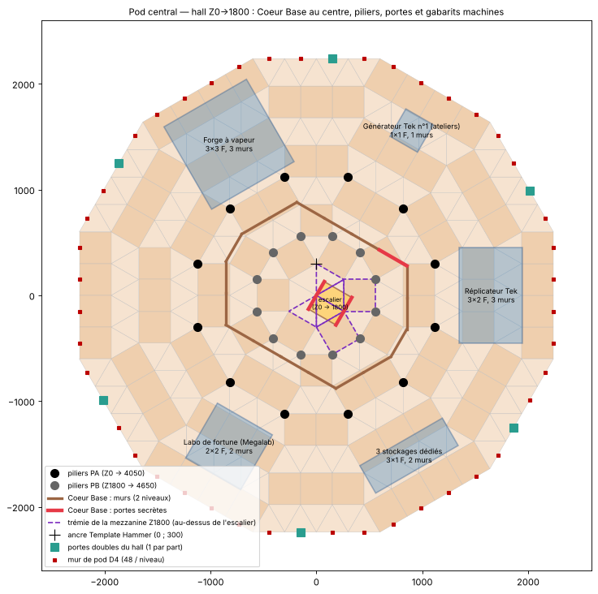

# Module 02 — Pod central de production (Ø15, hall, toit en rampes)

Templates (`templates/plans/`, module 06) :
- `Plan_4_pod_central.json` : mur de pod, murs de bord du trou dans le pod, piliers PA/PB, colonne d'escaliers, mezzanine Z1800 ;
- `Plan_6_toit_rampes.json` : plancher de toit Z2400, toit en rampes inclinées, casquette du trou.

Phases à l'intérieur des plans :
- **P2** : mur de pod niveaux 0-5, murs de bord du trou, piliers PA bas, 1re marche d'escalier ;
- **P3** : marches 2 à 6, mezzanine ;
- **P6** : mur niveaux 6-7, piliers hauts, plancher de toit Z2400, toit en rampes inclinées, casquette du trou.

Le Coeur Base n'est plus dans le projet : le centre du hall est libre. Coordonnées : `donnees/Plan_4_pod_central.csv`, `donnees/Plan_6_toit_rampes.csv`. Plans : `plans/plan_pod.png`, `plans/plan_rampes.png`.

## 1. Volumes

| Élément | Cotes | Remarque |
|---|---|---|
| Emprise du pod | Dodécagone **D4** : apothème 2 239,2 UU, Ø 14,93 fondations entre plats | c'est l'étoile existante (anneaux 1 à 7) |
| **Trou** | à l'avant (θ 180°), dès x ≈ −1 120 | le pod est fermé sur le gouffre par des murs de bord de toute la hauteur (§5) |
| **Colonne d'escaliers** | (129,9 ; −75), de Z0 à Z1800 | 6 escaliers empilés, à 186 UU du pilier de référence |
| **Hall d'atelier** | Z0 → Z1800 : **6 murs pleins de hauteur libre** | aucun plancher intermédiaire |
| Mezzanine / étage technique | Z1800 → Z2400 (2 murs) | même niveau que la galerie de tourelles |
| **Plancher de toit** | Z2400, sur tout le pod | au niveau du toit de cage : un seul plancher fermé du centre jusqu'à D5 |
| **Toit en rampes inclinées** | Z2400 → Z5100, sur tout le contour D5 (pod + cage), 21 poteaux en piliers fins | comme le toit des tours 1201 / 1809 ; aucun toit incliné |

## 2. Colonne d'escaliers

La colonne d'escaliers garde la place de l'ancien escalier du Coeur Base : une cellule de 300 × 300 centrée en (129,9 ; −75), axes tournés de −30°.

| Marche | Z | z template | Phase |
|---|---|---|---|
| 1 | 0 → 300 | 240 | P2 |
| 2 à 6 | 300 → 1800 | 540 · 840 · 1140 · 1440 · 1740 | P3 |

- Même x, y et yaw (−120°) pour les 6 escaliers.
- **Trémie de la mezzanine** : le script retire les 6 pièces du plancher Z1800 traversées par la cellule d'escalier. Ce sont 4 triangles du centre et 2 carrés de l'anneau 1 (θ 0° et θ 300°), tracés en violet sur le plan. On sort de l'escalier directement sur la mezzanine, puis on gagne la galerie de tourelles par les 11 cadres du niveau 6 du mur de pod.
- L'escalier monte en colonne libre dans le hall. Fermez-le si besoin par 4 murs : il reste 260 UU jusqu'aux piliers PB les plus proches.
- **Pilier de référence.** La pile d'ancrage est en (0 ; 300), à 186 UU de la cellule d'escalier. Démolissez-la à la fin.

## 3. Mur de pod (D4)

- **48 positions par niveau** (12 côtés × 4), **8 niveaux** de Z0 à Z2400.
- Le trou coupe 6 positions par niveau (côtés 150°, 180° et 210°) : il reste **319 murs + 17 cadres de porte doubles**.

| Niveau | Z | Ouvertures |
|---|---|---|
| 0 | 0 → 300 | **6 cadres doubles** (côtés E1, position 1 : θ ≈ 26°, 86°, 146°, 206°, 266°, 326°) : hall ↔ couloir annulaire |
| 1 à 5 | 300 → 1800 | aucune |
| **6** | 1800 → 2100 | **11 cadres doubles** (position 1 de chaque côté, sauf celui du côté 180°, dans le trou) : mezzanine ↔ galerie de tourelles |
| 7 | 2100 → 2400 | aucune ; le plancher de toit Z2400 se pose dessus |

## 4. Système porteur à piliers intérieurs

| Couronne | Position | Hauteur | Pièces | Rôle |
|---|---|---|---|---|
| **PA** | 12 coins de D2 : rayon 1 159,1, θ = 15° + 30°·k | Z0 → 2400 : 8 piliers | 96 | porte la mezzanine et le plancher de toit |
| **PB** | 12 coins de D1 : rayon 579,6, θ = 15° + 30°·k | Z0 → 2400 : 8 piliers | 96 | porte le centre de la mezzanine et du plancher de toit. Ils descendent jusqu'au sol pour qu'aucun plafond ne soit à plus de 2 cases d'un appui relié au sol (module 09) ; ils passent à 260 UU de la cellule d'escalier |

- Les 2 piliers PA à θ 165° et 195° sont aux sommets du bord du trou, en (−1 119,6 ; ±300) : ils restent en place et portent les murs de bord.
- La colonnade circulaire est décrite au module 03 §3.

## 5. Bord du trou dans le pod

Le trou entame le pod sur les anneaux 4 à 7 (27 pièces de l'étoile). Le pod est fermé sur le gouffre par des **murs de bord** posés sur les arêtes entre les fondations gardées et le trou :

| Élément | Valeur |
|---|---|
| Arêtes de bord dans le pod | 10, de x = −1 119,6 jusqu'à D4 |
| Hauteur | **8 murs**, Z0 → 2400, comme le mur de pod |
| Murs | **77**, plus 3 emplacements de tourelles au niveau 6 (Z1800 → 2100, module 06 §4) |
| Mezzanine et plancher de toit | s'arrêtent sur les murs de bord |
| Toit | la **casquette du trou** prolonge le toit au-dessus du gouffre (§8.3) |

## 6. Gabarits de placement des machines (hall Z0 → 1800)

Ce sont des zones de réservation, pas les cotes exactes des maillages. Elles commencent à 1 200 UU du centre, au-delà des piliers PA.

| Machine | Branche θ | Centre (x ; y) | Gabarit | Hauteur réservée | Énergie / carburant |
|---|---|---|---|---|---|
| **Réplicateur Tek** | 0° | (1 650 ; 0) | 3 × 2 fondations | 3 murs | à vérifier |
| **Générateur Tek n°1** | 60° | (900 ; 1 558,8) | 1 × 1 | 1 mur | élément |
| **Forge à vapeur** (Steam Forge) | 120° | (−825 ; 1 428,9) | 3 × 3 | 3 murs | élément (forge alimentée à l'élément) |
| *le trou* | 180° | — | — | — | — |
| **Labo de fortune** (Makeshift Megalab) | 240° | (−825 ; −1 428,9) | 2 × 2 | 2 murs | à vérifier |
| **9 stockages dédiés Tek** | 300° | (800 ; −1 385,6) | 5 × 2, en 2 rangées (4 + 5) | 2 murs | — |

Sur la mezzanine (Z1800) se trouvent le **générateur Tek n°2** en (−900 ; 0), puis **20 coffres-forts et 11 stockages dédiés** en alternance contre la face intérieure du mur de pod. Le trou supprime 5 des 36 emplacements ; les 9 stockages qui n'y trouvent plus de place sont dans le hall. Positions exactes : `donnees/07_equipements.csv` et module 07.

## 7. Mezzanine Z1800

Elle reprend le centre et les anneaux 1 à 7 en plafonds, **moins la trémie de l'escalier et les 27 pièces du trou** : 85 plafonds + 170 plafonds triangles.

## 8. Toit en rampes inclinées (comme les tours 1201 / 1809)

**Aucun toit incliné dans toute la base.** Sur un toit à 45°, on tient debout et rien ne glisse. Le bloc central est donc couvert par :
1. un **plancher de toit fermé à Z2400** sur le pod (87 plafonds + 174 triangles, sans le trou). Il prolonge le toit de cage (module 04) : le bloc central a un seul plancher étanche, du centre jusqu'à D5. Au droit du trou, il s'arrête sur les murs de bord, qui montent aussi à Z2400 ;
2. au-dessus, un **toit en rampes inclinées** (`StructureBP_Railing_Sloped_Metal`, la pièce des tours 1201 et 1809), tenu comme le toit des tours : chaque ligne de lames part du bord du plancher, et les lignes de plus de 6 lames ont un **poteau en piliers fins** debout sur le plancher Z2400 ;
3. au bord du trou, la **casquette du trou** : 12 lames qui descendent de Z2400 à Z2100 au-dessus du gouffre (§8.3).

La même règle sert pour la casquette, la pente A et l'overhang (modules 03 et 04).

### 8.1 Règle de pose, relevée sur les tours 1201 et 1809

- Le toit est fait de **lignes de lames** : des files de rampes inclinées bout à bout, parallèles à la pente, espacées de 300 UU (t = 0, ±300, ±600 le long de chaque côté).
- Chaque rampe monte de 300 UU sur 300 UU vers le centre. La rampe suivante d'une ligne est 300 UU plus loin et 300 UU plus haut.
- Pivot : au milieu de la rampe, 150 UU en retrait de son bas, à z template = Z du bas + 290. Sur la tour 1809, cela met le bas de la première rampe sur le dessus de la poutre fine d'égout (z 3 990).
- Rotation : **yaw = θ du côté − 90°**, ce qui fait monter la rampe vers le centre. C'est le cas de la tour 1201 : yaw −90° sur le côté θ = 0°. Les tours utilisent aussi la variante « Right » de la rampe : elle ne change que le côté de la ligne où se trouve la lame, pas sa position.
- **Appuis, comme sur les tours** (module 08 §3). Sur la tour 1809, chaque ligne part d'une poutre fine à l'égout. Sur un pan, elle finit sur un pilier fin debout sur la poutre de faîtage ; sur l'autre pan, elle monte librement, 6 lames depuis l'égout. La 1201 fait de même, avec 5 lames libres. D'où la règle appliquée au toit :
  - chaque ligne part d'un appui : ici le bord du plancher Z2400 à D5 ;
  - **au plus 6 lames libres** au-dessus du dernier appui ;
  - les lignes plus longues reçoivent un **poteau en piliers fins** debout sur le plancher Z2400, sous une jonction ;
  - au plus 7 lames entre deux appuis.
  - Option `--appuis prudent` : un poteau sous le bout haut de chaque ligne, comme le pan « faîtage » des tours.
- **Arêtes.** Aux 12 arêtes du toit, les lignes de deux côtés voisins se rejoignent. Deux lames qui se croiseraient ne peuvent pas être posées toutes les deux : le script retire la plus haute, en bout de ligne, si bien que chaque ligne reste continue depuis le plancher. Les lignes s'arrêtent donc un rang sur deux près des arêtes (5 lignes par côté au bas du toit, 3 au milieu, 1 au faîtage).
- **On ne tient pas debout sur une lame** : un dino largué n'y trouve aucune surface et glisse vers l'extérieur. Ce qui passe entre deux lames tombe sur le plancher fermé Z2400, au milieu des poteaux.
- **Au-dessus du trou, aucune lame** : une ligne s'arrête à sa première rampe au-dessus du gouffre.

### 8.2 Rangs du toit

La rampe de rive, 150 UU devant le bord du plancher, est la casquette du module 04.

| Rang | Apothème du pivot | Z du bas | Lignes par côté (hors trou) | **Rampes posées** |
|---|---|---|---|---|
| r0 | 2 649,0 | 2400 | 5 | 53 |
| r1 | 2 349,0 | 2700 | 3 à 5 | 43 |
| r2 | 2 049,0 | 3000 | 3 à 5 | 41 |
| r3 | 1 749,0 | 3300 | 3 | 31 |
| r4 | 1 449,0 | 3600 | 3 | 31 |
| r5 | 1 149,0 | 3900 | 1 à 3 | 21 |
| r6 | 849,0 | 4200 | 1 à 3 | 21 |
| r7 | 549,0 | 4500 | 1 | 11 |
| r8 | 249,0 | 4800 | 1 | 11 |
| **Total** | | faîtage Z5100 | | **263** |

**Poteaux du toit** : 21 poteaux, 43 piliers fins, tous debout sur le plancher Z2400.

| Ligne | Bout haut | Poteau (défaut) | Avec `--appuis prudent` |
|---|---|---|---|
| t = 0 (11 lignes, 9 lames) | Z5100, à 99 UU du centre | 3 piliers fins sous la 3e jonction (Z3300) : 6 lames libres au-dessus | 9 piliers fins sous le bout haut + 4 sous la 4e jonction |
| t = ±300 (10 lignes, 7 lames) | Z4500 | 1 pilier fin sous la 1re jonction (Z2700) | 7 piliers fins sous le bout haut |
| lignes de 6 lames ou moins | Z4200 au plus | aucun : la ligne monte librement depuis le bord du plancher | un poteau sous le bout haut |
| **Total** | | **21 poteaux, 43 piliers fins** | 54 poteaux, 295 piliers fins |

### 8.3 Casquette du trou

| Élément | Valeur |
|---|---|
| Où | en haut des 14 murs de bord qui montent à Z2400 (pod et couloir) |
| Lame | 1 rampe par mur, pivot 150 UU devant le mur côté gouffre, Z2100 → 2400, **yaw = sens du gouffre − 90°** (elle monte vers le mur) |
| Rampes | **12** ; les 2 lames des angles rentrants (θ ≈ 172° et 197°) croiseraient un mur ou une lame voisine et ne sont pas posées |
| Rôle | comme la casquette de D5 : ce qui glisse quitte le bord 300 UU devant les tourelles reposées au niveau 6 et tombe dans le gouffre |

- Coût : une rampe vaut environ **12 lingots + 3 pâte**, contre 35 + 10 pour un toit ; un pilier fin environ 13 + 4. ⚠ Ce sont des estimations : rambarde métal (Metal Railing) et demi-pilier métal.
- ⚠ À valider en solo :
  - le décalage de la rampe (+290 en z template) vient des tours 1201 et 1809. Si les rampes apparaissent trop haut ou trop bas, corrigez `+ 200` dans `pente()` et `bouts_lame()` et régénérez ;
  - la casquette du trou pend d'une lame au haut des murs de bord, comme la lame de rive de la tour 1201 : Template Hammer obligatoire.

## 9. Contrôles de fin de module

- [ ] 6 escaliers empilés de Z0 à Z1800 ; la trémie de la mezzanine est ouverte au-dessus.
- [ ] 6 murs libres sous la mezzanine ; 6 cadres doubles au sol et 11 à Z1800.
- [ ] Murs de bord du trou : 8 niveaux, du sol au plancher de toit, sans jour.
- [ ] 24 colonnes de piliers PA/PB, toutes du sol (Z0) à Z2400.
- [ ] Plancher de toit Z2400 fermé, sans jour, jusqu'aux murs de bord.
- [ ] Toit : 263 rampes en 12 pans, lignes au pas de 300 UU, 21 poteaux (43 piliers fins) ; casquette du trou : 12 lames. Aucun toit incliné.
