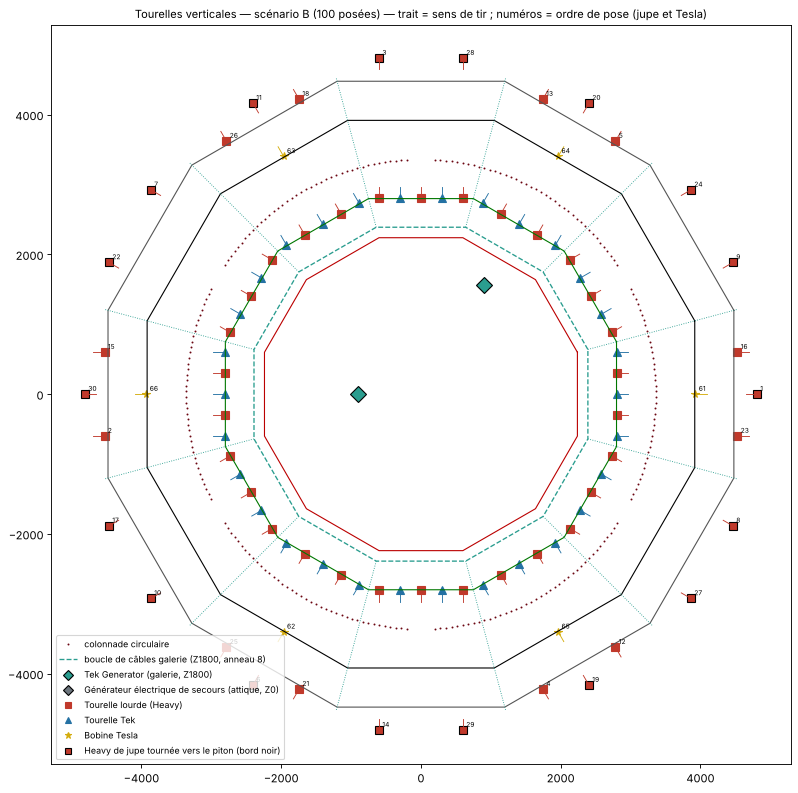

# Module 05 — Plan de câblage et matrice balistique (cap 100, Tesla comptées, 6 parts égales)

Templates :
- `templates/parts/Part_k_tourelles.json` : 16 tourelles par part ;
- ou `templates/phases/P7.json` / `templates/05_tourelles_scenario_B.json` : les 96 tourelles d'un bloc.

Chaque tourelle y est précédée de son **mur de chaume de pose**, à démolir en jeu.
Liste maîtresse : `donnees/05_matrice_tourelles.csv`. Elle donne l'ordre, le type, la couche, les coordonnées du chaume et de la tourelle, et le sens de tir.
Plan : `plans/plan_tourelles.png`.

## 1. Règle du turret cap

| Paramètre serveur | Valeur officielle documentée | Effet |
|---|---|---|
| `bLimitTurretsInRange` | true | active la limite |
| `LimitTurretsRange` | **10 000 UU** (≈ 33,3 fondations) | rayon de la **sphère** de comptage |
| `LimitTurretsNum` | **100** | tourelles au plus dans la sphère |

- Tourelles comptées : auto, Heavy, Tek, Plant Species X.
- **Hypothèse retenue (scénario B) : les Tesla comptent aussi.**
- À la pose, le jeu compte les tourelles déjà posées à moins de 10 000 UU (distance 3D) et refuse la pose si le cap est atteint.

## 2. Le cap est global sur cette base

| Mesure (sur les 96 tourelles) | Valeur |
|---|---|
| Distance 3D maximale entre deux tourelles | **9 692 UU** (< 10 000) |
| Rayon horizontal maximal (jupe) | 4 846 UU |
| Distance minimale d'une tourelle étrangère pour n'entrer dans aucune sphère | **14 846 UU ≈ 49,5 fondations du centre** |

Toutes les tourelles se voient entre elles : la base entière compte pour un seul cap de 100. Gardez une zone d'exclusion d'environ 50 fondations pour toute autre tourelle de votre tribu.

## 3. Répartition : 6 parts × 16 = 96

| Par part | Heavy | Tek | Tesla | Total |
|---|---|---|---|---|
| L1, cage (10 emplacements) | 5 | 5 | — | 10 |
| Jupe (5 emplacements) | 5 | — | — | 5 |
| Rive (1 emplacement) | — | — | 1 | 1 |
| **Par part** | **10** | **5** | **1** | **16** |
| **× 6 parts** | **60** | **30** | **6** | **96** |
| Inventaire | 80 | 35 | 10 | |
| Réserve | 20 | 5 | 4 | |

- 100 n'est pas divisible par 6, et il faudrait 36 Tek pour en mettre 6 par part. Le maximum symétrique est donc **96**.
- Le cap laisse 4 places pour un ajout manuel hors parts, par exemple les 4 Tesla restantes au milieu des côtés E1 de la rive.

## 4. Montage vertical : mur de chaume puis tourelle

| Type | pitch | yaw | roll | Référence |
|---|---|---|---|---|
| Heavy, Tek | −89,5° | θ_tir + 90° | −90° | template 2727 *Straight Heavy* |
| Tesla | 0° | θ_tir + 90° | −90° | Tesla latérales des tours 1201 / 1809 |

| Couche | Mur de chaume (Z bas → haut, z template) | Pivot de la tourelle |
|---|---|---|
| L1 | ligne D5 (2 799,0), Z1800 → 2100, z 2040 | apothème 2 809,0, z 2040 |
| RIVE | ligne D7 (3 918,7), milieu des côtés E0, Z300 → 600, z 540 | apothème 3 928,7, z 540 |
| JUPE-ext | sous le mur d'about (4 518,7), suspendu Z −900 → −600, z −660 | apothème 4 528,7, vers la mer |
| JUPE-int | sous la jonction des plafonds s1/s2 (4 818,7), suspendu Z −900 → −600, z −660 | apothème 4 808,7, vers le piton |

⚠ **À valider en solo** :
- l'accroche d'un mur de chaume sous un plafond (jupe) ;
- le maintien de la tourelle après démolition du chaume.

## 5. Ordre de pose

- **Posé par parts** (`Part_k_tourelles`) : 16 tourelles à la fois. Le cap n'est jamais atteint (96 < 100).
- **Posé d'un bloc** (`P7`), l'ordre suit des priorités. À l'intérieur de chacune, il suit la suite de van der Corput (0°, 180°, 90°, 270°…), pour rester réparti si la pose s'interrompt.

| Priorité | Ordres | Contenu |
|---|---|---|
| P1 | 1-30 | 30 Heavy de jupe (dessous de la plateforme et mer) |
| P2 | 31-60 | 30 Tek en L1 (seule couche qui tire vers le haut) |
| P3 | 61-66 | 6 Tesla de rive (pied de mur) |
| P4 | 67-96 | 30 Heavy en L1 |

## 6. Matrice détaillée

H = Heavy, T = Tek, S = Tesla, suivi du n° d'ordre. L1 : positions p0 à p4 dans le sens des θ croissants. Jupe : dans l'ordre t = −600 → +600.

| Part | Côté (θ) | L1 p0 | p1 | p2 | p3 | p4 | Jupe | Rive |
|---|---|---|---|---|---|---|---|---|
| 1 | 0° | T53 | H89 | T31 | H67 | T46 | ext 23, int 1, ext 16 | S61 |
| 1 | 30° | H82 | T39 | H75 | T54 | H90 | int 9, int 24 | — |
| 2 | 60° | T35 | H71 | T50 | H86 | T43 | ext 5, int 20, ext 13 | S64 |
| 2 | 90° | H79 | T58 | H94 | T33 | H69 | int 28, int 3 | — |
| 3 | 120° | T48 | H84 | T41 | H77 | T56 | ext 18, int 11, ext 26 | S63 |
| 3 | 150° | H92 | T37 | H73 | T52 | H88 | int 7, int 22 | — |
| 4 | 180° | T45 | H81 | T60 | H96 | T32 | ext 15, int 30, ext 2 | S66 |
| 4 | 210° | H68 | T47 | H83 | T40 | H76 | int 17, int 10 | — |
| 5 | 240° | T55 | H91 | T36 | H72 | T51 | ext 25, int 6, ext 21 | S62 |
| 5 | 270° | H87 | T44 | H80 | T59 | H95 | int 14, int 29 | — |
| 6 | 300° | T34 | H70 | T49 | H85 | T42 | ext 4, int 19, ext 12 | S65 |
| 6 | 330° | H78 | T57 | H93 | T38 | H74 | int 27, int 8 | — |

Le motif est le même dans chaque part : sur L1, Tek et Heavy alternent sans interruption sur les 60 emplacements.

## 7. Couverture et zones d'ombre

| Couche | Couverture verticale | Limite |
|---|---|---|
| L1 | −49,0° → +38,2°, ≈ 180° en azimut par tourelle | pente A en bas, bout de casquette en haut |
| JUPE-ext | −89,9° → +17,0° vers la mer | plafond de jupe |
| JUPE-int | −89,9° → +37,2° vers le piton et le dessous de la plateforme | plafond de jupe ; sous-face de plateforme non modélisée |
| Tesla | toute la bande décaissée (3 919 → 4 479 UU) | poche fermée sous l'overhang |

**Zones d'ombre traitées**
- Pied de rive : 6 Tesla et 84 pics.
- Dessous de la plateforme : 18 Heavy tournées vers le piton (3 par part).
- Mer au pied du piton : 12 Heavy tournées vers l'extérieur, plus L1 jusqu'à −49°.

**Non couvert** : le ciel au-dessus de +38°. Les toits à 45° font glisser tout ce qui est largué.

## 8. Plan de câblage : 2 générateurs Tek

| Source | Position | Rôle | Portée à régler |
|---|---|---|---|
| **Générateur Tek n°2** (mezzanine) | (−900 ; 0), Z1800 | **30 Tek de L1**, entre 1 915 et 3 760 UU | **≥ 3 800 UU** |
| **Générateur Tek n°1** (hall) | (900 ; 1 559), Z0 | réplicateur, forge à vapeur, labo, puis secours de L1 jusqu'à 5 040 UU | maximum |

- Les **Tek** exigent un générateur Tek.
- Les **Heavy et Tesla** sont électriques. Celles de la jupe sont à 4 500–6 650 UU des générateurs, les Tesla de rive à 2 200–5 750 UU.
- Si les sphères ne les couvrent pas, posez des câbles électriques :
  - boucle sous le plancher Z1800 ;
  - descentes par les 6 passages de la colonnade ;
  - liaison vers la jupe par la bande sous l'overhang.
  Il faut alors un générateur électrique, absent de votre liste et non compté au module 07.

⚠ Vérifiez en jeu la sphère de portée des générateurs Tek au réglage maximal.

## 9. Réglages et munitions

| Tourelle | Portée | Cibles | Munitions |
|---|---|---|---|
| Heavy | Haute | survivants + créatures apprivoisées non alliées | balles de fusil avancé |
| Tek | Haute | idem | fragments d'élément |
| Tesla | — | idem ; mode brûlure, étourdissement ou vulnérabilité | cristal |

## 10. Contrôles

- [ ] 96 tourelles : 60 Heavy, 30 Tek, 6 Tesla. Chaque part a son motif L1 T H T H T / H T H T H.
- [ ] Les 18 de jupe « int » tirent vers le piton, les 12 « ext » vers la mer.
- [ ] 96 murs de chaume démolis ; les tourelles restent en place.
- [ ] Les 30 Tek sont alimentées par le générateur n°2.
- [ ] Réserve : 20 Heavy, 5 Tek, 4 Tesla ; zone d'exclusion d'environ 50 fondations respectée.
