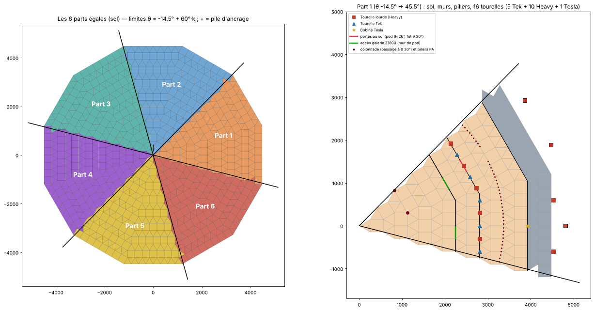

# Module 06 — Plan complet en 6 parts égales

Ce plan contient sol, structure, colonnade, toitures et tourelles. Les outils de production et de stockage n'en font pas partie : ils figurent au [module 07](07_Bilan_Materiaux.md).

**Principe.** La forteresse est découpée en **6 parts identiques de 60°**. On passe de l'une à la suivante par une rotation de 60° autour du centre. Un seul élément n'entre pas dans ce découpage : le **noyau central** (Coeur Base, escalier, centre de la mezzanine, pointe du cône), qui n'a pas de symétrie et se pose une seule fois.

Templates : `templates/parts/`. Coordonnées de la part 1, avec la phase de chaque pièce : `donnees/06_part_1_structure.csv`. La part k s'obtient en tournant la part 1 de 60°·(k − 1).

## 1. Découpage

| Part | Secteur θ | Côtés de dodécagone | Coins (piliers PA/PB) |
|---|---|---|---|
| 1 | −14,5° → 45,5° | 0° (E0) et 30° (E1) | 15° et 45° |
| 2 | 45,5° → 105,5° | 60° et 90° | 75° et 105° |
| 3 | 105,5° → 165,5° | 120° et 150° | 135° et 165° |
| 4 | 165,5° → 225,5° | 180° et 210° | 195° et 225° |
| 5 | 225,5° → 285,5° | 240° et 270° | 255° et 285° |
| 6 | 285,5° → 345,5° | 300° et 330° | 315° et 345° |

- Une pièce appartient à la part qui contient son centre.
- Les limites sont décalées de 0,5° par rapport aux arêtes (−15° + 60°·k). Sans ce décalage, les piliers d'angle situés exactement sur une limite seraient attribués au hasard.
- Le script vérifie que **les 6 parts sont identiques à une rotation près** : même classe, même cote, position à moins de 1 UU, pour la structure comme pour les tourelles.

## 2. Contenu d'une part (identique pour les 6)

### Structure : 971 pièces

| Élément | Pièces par part | Détail | Phase |
|---|---|---|---|
| Sol (étoile, anneaux 1-15, dont la bande décaissée) | 192 | 64 fondations + 128 triangles | P1 |
| Mur de pod D4 (10 niveaux) | 80 | 77 murs + 3 cadres doubles (1 porte au sol, 2 accès galerie) | P2 / P6 |
| Piliers PA (2 colonnes) | 28 | 26 piliers + 2 demi-piliers | P2 / P6 |
| Piliers PB (2 colonnes) | 20 | 18 piliers + 2 demi-piliers | P6 |
| **Colonnade** (40 colonnes, 1 passage à θ 30°) | 160 | 128 piliers + 32 demi-piliers | P2 |
| Fût D5 (6 niveaux) | 60 | 59 murs + 1 cadre double (porte au sol) | P2 |
| Rive D7 (2 niveaux) | 27 | 27 murs. Il reste 1 emplacement libre au niveau 1 pour la Tesla | P2 |
| Mezzanine Z1800 (hors centre) | 45 | 15 plafonds + 30 triangles | P3 |
| Planchers de galerie Z1800, 2100, 2400 | 81 | 26 plafonds + 54 triangles + 1 trappe | P3 / P5 |
| Pente A (4 rangs) | 52 | toits | P4 |
| Overhang (4 rangs, dont 2 dans le vide) | 72 | toits | P4 |
| Jupe | 74 | 36 murs + 38 plafonds | P4 |
| Cage L2 | 10 | cadres doubles | P5 |
| Casquette | 12 | toits | P5 |
| Reprise | 20 | toits | P6 |
| Cône (7 rangs) | 38 | toits | P6 |
| **Total** | **971** | lingots ≈ 27 595 ; pâte ≈ 7 983 | |

### Tourelles : 16 par part, chacune avec son mur de chaume

| Couche | Position dans la part | Tourelles |
|---|---|---|
| L1, côté E0 | 5 emplacements : T H T H T | 3 Tek + 2 Heavy |
| L1, côté E1 | 5 emplacements : H T H T H | 2 Tek + 3 Heavy |
| Jupe, côté E0 | vers la mer (t = −600), vers le piton (t = 0), vers la mer (t = +600) | 3 Heavy |
| Jupe, côté E1 | vers le piton (t = ±600) | 2 Heavy |
| Rive, côté E0 | milieu du côté, niveau 1 (Z300 → 600) | 1 Tesla |
| **Total** | | **5 Tek + 10 Heavy + 1 Tesla = 16** (+ 16 murs de chaume) |

**À la pose** :
- Ligne des murs de pics : 14 Metal Spike Walls par part (7 par côté). Ils se posent à la main ; coordonnées dans `donnees/03_ligne_pics.csv`. Leur classe Unreal ne figure dans aucun des templates fournis, c'est pourquoi le template ne les contient pas.
- Démolition des 16 murs de chaume après la pose des tourelles.

## 3. Noyau central (posé une seule fois)

`templates/parts/Noyau_central.json`, 106 pièces :

| Élément | Pièces |
|---|---|
| Coeur Base sans ses fondations ni son coffre (le coffre est compté dans les 20 coffres-forts, module 07) | 35 murs, 3 portes secrètes, 1 escalier, 40 plafonds triangles, 5 plafonds |
| Escalier prolongé jusqu'à Z1800 | 5 escaliers |
| Centre de la mezzanine Z1800, avec la trémie de l'escalier | 4 plafonds + 8 plafonds triangles |
| Capuchon et pointe du cône | 1 plafond + 4 demi-toits |

## 4. Ce que la symétrie a changé

Six parts égales imposent que tout élément unique soit présent dans chaque part ou dans aucune.

| Élément | Version précédente | Version en 6 parts |
|---|---|---|
| Portes au sol du pod | 4 (θ 90° / 270°) | **6**, 1 par part (côté E1, position 1). Celle de la part 1 est à θ ≈ 26°, face à la porte du Coeur Base |
| Portes au sol du fût | 2 | **6** (θ 30° + 60°·k) |
| Trappes de la galerie L2 | 3 | **6** |
| Passages de la colonnade | 2 (256 colonnes) | **6** (240 colonnes), dans l'axe des portes du fût |
| Sas dans la rive | 1 (θ 270°) | **supprimé** : 6 sas feraient 6 brèches. Accès par Tek Teleporter, ou sas percé à la main hors template |
| Bobines Tesla | 10 | **6** (1 par part, au milieu des côtés E0) |
| Tourelles | 55 H + 35 T + 10 S = 100 | **60 H + 30 T + 6 S = 96** |
| Réserve | 25 H | **20 H + 5 T + 4 S** |

**Pourquoi 96 et pas 100.** Avec 35 Tek et 10 Tesla, il est impossible de faire 6 parts identiques qui totalisent 100 : 100 n'est pas divisible par 6, et 6 Tek par part en demanderaient 36. 16 par part donnent 96 ≤ 100.

**Option hors symétrie.** Le cap laisse 4 places. Vous pouvez poser à la main les 4 Tesla restantes, par exemple au milieu des côtés E1 de la rive (θ 90°, 150°, 270°, 330°), avec le même montage sur mur de chaume. Elles ne sont pas dans les templates de part.

## 5. Ordre de pose par parts

| Étape | Template | Remarque |
|---|---|---|
| 1 | `parts/Part_1_structure.json` | contient la pile d'ancrage de 2 demi-piliers en (0 ; 300) (`snapOverrides [0,1]`) |
| 2 à 6 | `parts/Part_2_structure.json` … `Part_6_structure.json` | chacun a 1 demi-pilier qui se pose sur la pile (`snapOverrides [0]`) ; ils sont déjà tournés, aucune rotation à faire |
| 7 | `parts/Noyau_central.json` | Coeur Base, escalier, centre de la mezzanine, pointe |
| 8 à 13 | `parts/Part_1_tourelles.json` … `Part_6_tourelles.json` | 16 paires mur de chaume + tourelle par part. 96 tourelles au total, sous le cap |
| 14 | à la main | démolition des 96 murs de chaume, 84 pics, portes doubles, échelles, équipements (module 07), démolition de la pile d'ancrage |

- Dans chaque template de part, les pièces sont **triées par phase** (sol → piliers et murs → plafonds → rampes → cage → dôme). L'ordre des accroches est donc respecté à l'intérieur de la part.
- ⚠ Une part posée d'un bloc contient des pièces dont l'appui est en partie dans la part voisine : toits des arêtes, plafonds en limite. Si Template Hammer refuse des pièces faute d'appui, utilisez les templates par phase (`templates/phases/P1` à `P7`). Ils contiennent exactement les mêmes pièces, posées couche par couche sur tout le tour.

## 6. Contrôles

- [ ] Après les 6 structures et le noyau : contour D8 complet, 6 portes au sol du pod et 6 du fût, 6 passages dans la colonnade.
- [ ] Après les 6 templates de tourelles : 60 Heavy, 30 Tek, 6 Tesla. Le compteur du cap ne bloque pas.
- [ ] 96 murs de chaume démolis ; les tourelles restent en place.
