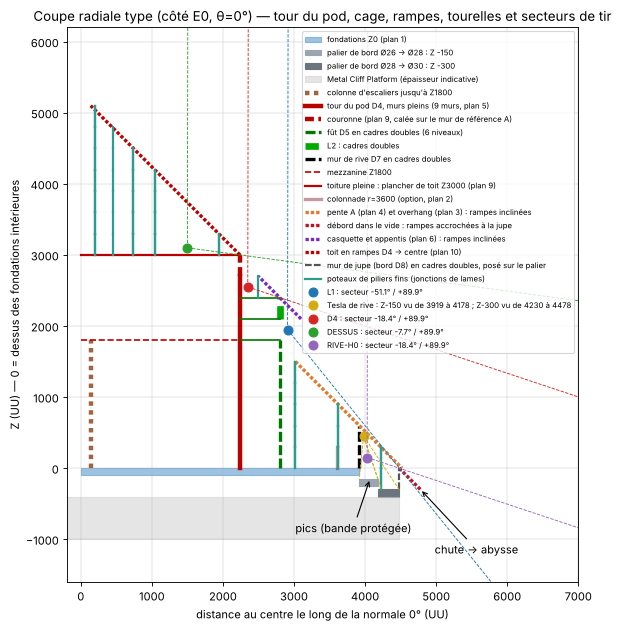

# Forteresse circulaire Ø30 sur Metal Cliff Platform — Notice de montage

Base PvP circulaire de 30 fondations pour **ARK: Survival Ascended**, posée sur une Metal Cliff Platform au sommet d'un piton rocheux en pleine mer.

Le centre est une **tour** (le pod), dont vous pouvez faire varier la hauteur. À l'avant de la plateforme, un **trou** (gouffre) entame la base : la construction est adaptée à votre relevé (module 06). Le dossier contient :
- les templates **Template Hammer** (format JSON des exports Wikily.gg), en **11 plans par zone** et une option ;
- un document par module ;
- les coordonnées de chaque pièce (CSV) ;
- le bilan matériaux complet (Markdown et Excel) ;
- le générateur Python qui produit tout cela.

| Module | Document | Ce qu'il couvre |
|---|---|---|
| 01 | [01_Sol_Fondations_Decaissement.md](01_Sol_Fondations_Decaissement.md) | Calpinage carrés + triangles en étoile, Ø30, **bord abaissé en 2 paliers** (Ø26 → −150, Ø28 → −300), fondations du trou |
| 02 | [02_Pod_Central_Atelier.md](02_Pod_Central_Atelier.md) | **Tour du pod** en murs pleins, hall, escaliers, piliers, mezzanine, **noyau** (générateurs et boîtes de munitions en cage) ; **toit D4 → centre calé sur un mur de D4** (toiture pleine, toit en rampes) ; rehausse |
| 03 | [03_Rampe_Glisse_Overhang.md](03_Rampe_Glisse_Overhang.md) | Rive (2 Heavy par côté) et jupe en cadres doubles, **rampes de glisse** (pente A, overhang, débord) et leurs **poteaux de stabilité**, colonnade en option, ligne de pics |
| 04 | [04_Tourelles_DoubleDoorframes.md](04_Tourelles_DoubleDoorframes.md) | Cage D5 → D4 en cadres doubles : tourelles verticales L1, L2, casquette, **appentis** vers la tour |
| 05 | [05_Defense_Cap_Repartition.md](05_Defense_Cap_Repartition.md) | **Cap de 100** : Heavy, Tek, Tesla et **Plant Species X**, aucune sous Z0 ; 3 plans de défense ; **couverture** ; noyau et câblage |
| 06 | [06_Plans_et_Trou.md](06_Plans_et_Trou.md) | **Trou à l'avant**, plateforme verte et **les 11 plans par zone** |
| 07 | [07_Bilan_Materiaux.md](07_Bilan_Materiaux.md) | **Bilan matériaux complet**, équipements compris : réplicateur, forge à vapeur, labo de fortune, 20 stockages dédiés, 20 coffres-forts, 2 générateurs Tek, 2 boîtes de munitions |
| 08 | [08_Revue_Constructibilite.md](08_Revue_Constructibilite.md) | **Revue de constructibilité** : comparaison avec vos templates, appuis et redondance des rampes, murs de chaume, collisions, ordre de pose, revue du code |
| 09 | [09_Audit_Limites_Moteur.md](09_Audit_Limites_Moteur.md) | **Audit des limites moteur** : 8 400 structures, 100 places au cap, plafonds à 2 cases d'un appui au sol, 70 murs de haut |



---

## 1. Ce qu'il faut retenir

1. **11 plans par zone** (module 06), chacun sous 2 000 entrées, à poser dans l'ordre :

   | Plan | Contenu |
   |---|---|
   | 1 | sol complet |
   | 2 | colonnade (option) |
   | 3 | bord D8 → D7 |
   | 4 | D7 → D5 |
   | 5 | tour du pod |
   | 6 | D5 → D4 |
   | 7 | défense D8 → D4 |
   | 8 | défense du périmètre du pod |
   | 9 | toiture pleine D4 → centre |
   | 10 | toit en rampes D4 → centre |
   | 11 | défense du dessus |
   | option | rehausse de la tour (+1 niveau) |

   Dans chaque plan, chaque pièce vient après ce qui la porte, et aucun plan ne s'appuie sur un plan posé plus tard.
2. **Le pod est une tour en murs pleins**, du sol à Z2700 par défaut. Son toit se cale sur un **mur de D4 de référence**, qui se snappe sur le haut de la tour. Vous pouvez donc la rehausser d'autant de niveaux que vous voulez pour la reproduction ; la toiture, le toit en rampes et les tourelles du dessus suivent.
3. **Tous les murs sont des cadres de porte doubles**, comme sur les tours 1201 et 1809, **sauf ceux de la tour du pod** : murs pleins, percés de ses portes.
4. **Toit en rampes D4 → centre** posé sur une **toiture pleine** (plancher fermé) : 170 rampes et 96 poteaux de piliers fins sous les jonctions de lames. La toiture pleine peut aussi rester seule, en toit plat.
5. **Poteaux de stabilité** : chaque ligne de rampes qui monte a des poteaux en plus de ceux des tours (toit, pente A, appentis). Elle tient encore si l'un de ses appuis est détruit : 431 lames sur 431. Ils **remplacent la colonnade**, qui passe en option.
6. **Défense : 100 places au cap, Tesla et Plant X comprises** : 49 Heavy, 26 Tek, 10 Tesla et 15 Plant Species X (en carrés de culture). **Aucune tourelle sous le niveau des fondations centrales** (Z0) : les Heavy de la jupe sont remplacées par une 2e Heavy de rive par côté. Elles sont réparties en 3 plans :
   - du bord à D4 ;
   - le périmètre de la tour ;
   - le dessus.

   Le générateur vérifie la couverture de **tous les angles d'approche** au-dessus de la plateforme (module 05 §7) ; le dessous de la plateforme n'est plus couvert. Deux tourelles sont toujours à 300 UU l'une de l'autre au moins. Il reste en réserve 31 Heavy et 9 Tek.
7. **Noyau** (module 02 §6.1) : 2 générateurs Tek (principal et secours) et 2 boîtes de munitions, chacun sur une fondation de l'anneau 1, au centre, dans une cage de murs métal de 2 niveaux avec plafond et porte double.
8. **Le trou à l'avant** (θ 180°) suit votre image annotée :
   - 124 fondations retirées ;
   - 10 fondations de plateforme verte, sans rien dessus ;
   - la base est fermée sur le gouffre par des murs de bord ;
   - 12 lames de casquette du trou ;
   - 8 tourelles face au gouffre.
9. **Tourelles verticales** sur mur de chaume, comme le template 2727 et la tour 1809. Les 79 murs de chaume sont dans les plans de zone, à leur place dans les murs ; **démolissez-les après la pose des tourelles** (`donnees/08_chaume_a_demolir.csv`).
10. **Coût** : il reste à fabriquer ≈ **143 600 lingots de métal** et **36 500 pâte cimentée**, équipements compris (sauf les boîtes de munitions, coût non relevé), hors tourelles (déjà en inventaire). La colonnade en option coûte 5 650 lingots ; chaque niveau de rehausse, 1 900 lingots (module 07).
11. **Limites moteur** (module 09) :
    - 5 691 structures (5 779 au plus fort du chantier) pour un plafond de 8 400 ;
    - 17 murs de haut ;
    - aucun plafond à plus de 2 cases d'un appui au sol.
12. **Aucun toit incliné : des rampes partout.** Sur un toit à 45°, on tient debout ; sur des rampes inclinées (Sloped Railing), rien ne tient et tout glisse : 758 rampes en lignes de lames, comme sur les tours. Rien n'est accroché sous les fondations : le débord est une seule lame pendue au haut de la jupe.

## 2. Conventions (relevées dans les templates fournis)

| Grandeur | Valeur | Origine |
|---|---|---|
| Fondation | 300 × 300 UU ; triangle de côté 300, hauteur 259,81 | Floor_Metal / BP_TriFoundation_Metal |
| Niveau (mur) | 300 UU | Wall_Metal, BP_DoubleDoorframe_Metal |
| Repère | origine = centre de l'étoile ; θ = atan2(y, x) = yaw Unreal ; axe 0° = première branche de carrés ; le trou est à θ 180° | template 481, votre relevé du trou |
| Cote plan **Z** | 0 = dessus des fondations intérieures | — |
| z template | fondation Z + 40 · mur, cadre Z_bas + 240 · plafond Z + 90 · pilier Z_bas + 240 · carré de culture, tourelle debout Z + 100 | templates 1201, 1087, 1584, mho |
| Triangle | pivot à mi-hauteur, yaw = base → pointe (aussi valable à ± 120°) | contrôle 481 : 282/282 |
| Rampe inclinée (StructureBP_Railing_Sloped_Metal) | lignes de lames au pas de 300 ; +300 UU en hauteur par pas de 300 UU ; pivot au milieu de la rampe, z template = Z du bas + 290 ; yaw = θ du côté − 90° | tours 1201, 1809 |
| Appui d'une ligne de rampes | part d'un haut de mur, d'un bord de plancher ou d'une tête de pilier ; au plus 6 lames libres, 7 entre deux appuis, 1 seule en porte-à-faux ; **poteaux de stabilité** sous les jonctions 1, 4, 7… et le bout haut des lignes montantes | tours 1809 et 1201 ; votre demande |
| Tourelle verticale | mur de chaume dans l'emplacement ; pivot 10 UU devant, à mi-hauteur ; Heavy/Tek : pitch −89,5°, yaw θ_tir + 90°, roll −90° ; Tesla : pitch 0°, yaw θ_tir + 90°, roll −90° | templates 2727, 1809 |
| Mur de référence (plans 9 à 11, rehausse) | mur de D4 du côté θ 90° : A (x = +150, au-dessus de la porte du hall), B (−150), C (−450) ; il se snappe sur le haut de la tour | ce projet |
| Pilier « large » | Pillar_Metal, largeur prise à 39,3 UU (1 pilier / 1 vide) | template 704 |

### Contours de référence : dodécagones D(n)

| Contour | Rôle | Apothème (UU) | Rayon des coins | Ø entre plats (fondations) | Pièces par côté |
|---|---|---|---|---|---|
| D1 / D2 | coins = piliers PB / PA | 559,8 / 1 119,6 | 579,6 / 1 159,1 | 3,73 / 7,46 | 1 / 2 |
| **D4** | tour du pod (= étoile 481) | 2 239,2 | 2 318,2 | 14,93 | 4 |
| **D5** | fût de la cage | 2 799,0 | 2 897,8 | 18,66 | 5 |
| *cercle* | colonnade (option) | rayon 3 600 | — | 24,0 | 288 positions |
| **D7** | mur de rive | 3 918,7 | 4 056,9 | 26,12 | 7 |
| **D8** | bord de la plateforme, mur de jupe (1 niveau, sur le palier 2) | 4 478,5 | 4 636,4 | 29,86 | 8 |

## 3. Contenu du dépôt

| Chemin | Contenu |
|---|---|
| `templates/plans/Plan_01…11_*.json` | **Les 11 plans par zone**, à poser dans l'ordre (§5) |
| `templates/plans/Option_rehausse_pod_+1_niveau.json` | Un niveau de plus pour la tour du pod |
| `templates/test/Secteur_test_theta_-15_45.json` | Essai en solo : un secteur de 60° de tous les plans (module 08 §7) |
| `references/Trou_points_ancrage.json` | Votre export *trou* (60 fondations + pilier de référence), qui sert au recalage |
| `references/Trou_fondations.json` | Fondations du trou relevées sur votre image : `retirees` (blanc), `plateforme` (vert) |
| `donnees/Plan_*.csv` | Toutes les pièces de chaque plan, dans l'ordre des entrées du template |
| `donnees/05_matrice_tourelles.csv` | Les 100 places du cap : ordre, type, couche, plan, support, tourelle, sens de tir |
| `donnees/05_couverture.csv` | Couverture : tourelles qui voient chaque point d'approche, tous les 10° |
| `donnees/06_bord_du_trou.csv` | Murs de bord du trou : position, sens, hauteur |
| `donnees/08_chaume_a_demolir.csv` | Les 79 murs de chaume à démolir : plan, n° d'entrée, tourelle portée, ce qui est posé au-dessus |
| `donnees/07_bilan_materiaux.xlsx` | Bilan matériaux en Excel : synthèse, coût et nombre de structures de chaque plan avec récapitulatif, détail modifiable |
| `donnees/07_equipements.csv`, `03_colonnade.csv`, `03_ligne_pics.csv`, `synthese.json` | Équipements, colonnade, pics, toutes les cotes et tous les bilans |
| `plans/*.png` | Coupe radiale, calpinage, trou et sol, pod, rampes, tourelles et câblage, couverture |
| `outils/forteresse.py` | Générateur (Python 3) |
| `outils/bilan_xlsx.py` | Classeur Excel, depuis `donnees/synthese.json` |

## 4. Pré-requis

- Mod **Template Hammer**. Testez d'abord en solo, avec la même plateforme (`templates/test/`).
- **Pile d'ancrage en (0 ; 300)**, au sommet de l'hexagone central situé à θ 90°. C'est votre **pilier de référence**, celui de votre export *trou*.
  - Le plan 1 pose 2 demi-piliers empilés (`snapOverrides [0,1]`).
  - Les plans 2 à 8 portent 1 demi-pilier qui se pose sur cette pile (`snapOverrides [0]`).
  - Démolissez la pile à la fin.
- **Murs de référence** des plans 9, 10, 11 et de la rehausse : un mur de D4 du côté θ 90° (face à la pile d'ancrage), qui se snappe sur le haut de la tour :
  - **A** (x = +150), juste au-dessus de la porte du hall : toiture pleine et rehausse ;
  - **B** (x = −150) : tourelles du dessus ;
  - **C** (x = −450) : toit en rampes.

  Visez le haut du mur de la tour à la même place. Vérifiez dans l'aperçu que le plancher tombe dans la tour : sinon, tournez de 180°.
- **Orientation** : l'axe 0° des templates correspond à la branche de carrés orientée vers la droite sur `plans/plan_calpinage.png`, à l'opposé du trou.
- **Réglages serveur** : `LimitTurretsNum`, `LimitTurretsRange`, limite de structures (module 09).
- **Étoile déjà construite** : dans le plan 1, sautez les pièces déjà en place et retirez de votre étoile les 27 pièces qui tombent dans le trou (anneaux 4 à 7, côté θ 180°).

## 5. Séquence de pose : 11 plans

**Une seule règle** : chaque pièce est posée après ce qui la porte. Le générateur déduit ces appuis de la géométrie (`porteurs()`), range chaque plan du bas vers le haut et vérifie qu'aucun plan ne s'appuie sur un plan posé après lui.

| # | Fichier (`templates/plans/`) | Contenu | Entrées | Calage |
|---|---|---|---|---|
| 1 | `Plan_01_sol_complet.json` | toutes les fondations (paliers et plateforme verte compris), pile d'ancrage | 1 030 | pile |
| 2 | `Plan_02_colonnade_option.json` | **option** : colonnade de 226 piliers sous la pente A | 227 | pile |
| 3 | `Plan_03_bord_D8-D7.json` | rive et jupe en cadres doubles, overhang et débord, poteaux sur les paliers, chaume de la rive | 660 | pile |
| 4 | `Plan_04_D7-D5_pente_A.json` | pente A et ses 146 poteaux de stabilité, murs de bord du trou | 808 | pile |
| 5 | `Plan_05_tour_du_pod_D4.json` | tour du pod en murs pleins jusqu'à Z2700, piliers PA/PB, escaliers, mezzanine, cages du noyau, chaume de l'anneau D4 | 982 | pile |
| 6 | `Plan_06_D5-D4_cage_et_appentis.json` | fût, L1 et L2 en cadres doubles, galeries, casquette, appentis et ses poteaux, chaume de L1 | 1 046 | pile |
| 7 | `Plan_07_tourelles_D8-D4.json` | 41 Heavy, 18 Tek, 6 Tesla, 5 grands carrés de culture | 71 | pile |
| 8 | `Plan_08_tourelles_perimetre_pod.json` | 6 Heavy, 6 Tek, 2 Tesla, 6 carrés de culture moyens | 21 | pile |
| — | `Option_rehausse_pod_+1_niveau.json` | **option, autant de fois que voulu** : +1 niveau de tour | 76 | mur A |
| 9 | `Plan_09_toiture_pleine_D4-centre.json` | couronne, piliers PA/PB, plancher de toit (toit plat, trappe) | 335 | mur A |
| 10 | `Plan_10_toit_en_rampes_D4-centre.json` | toit en rampes, 96 poteaux, casquette du trou | 467 | mur C |
| 11 | `Plan_11_tourelles_dessus.json` | 2 Heavy, 2 Tek, 2 Tesla, 4 carrés de culture, debout sur le plancher de toit | 11 | mur B |

**Notes**
- Les plans 10 et 11 se posent sur la toiture pleine (plan 9), dans l'ordre que vous voulez. Pour un toit plat, ne posez pas le plan 10.
- **Rehausse** : posez-la entre le plan 8 et le plan 9. L'anneau de tourelles D4 reste juste au-dessus du toit de cage. Le générateur refait tous ses contrôles sur la tour rehaussée d'un niveau.
- **Colonnade** : si vous l'excluez, ne posez pas le plan 2 ; rien ne s'y appuie.

### Finitions

1. **Démolissez les 79 murs de chaume** (`donnees/08_chaume_a_demolir.csv`), après la pose de leur tourelle. Testez d'abord sur une tourelle qu'elle reste en place, avec ce qui est posé au-dessus.
2. Plantez les **15 graines de Plant Species X** dans les carrés de culture. Apportez de l'eau (tuyaux ou réservoirs) et de l'engrais.
3. Posez les 74 Metal Spike Walls (`donnees/03_ligne_pics.csv`).
4. Posez les portes doubles dans les cadres à fermer (hall, fût, accès galerie, rive) et les échelles : 5 sous les trappes de la galerie, 1 vers la trappe du toit.
5. Posez les équipements aux emplacements prévus (module 07 §3) : générateurs Tek et boîtes de munitions dans les cages du noyau, portes doubles fermées. Puis le câblage (module 05 §8).
6. Démolissez la pile d'ancrage.

## 6. Bilan matériaux (détail : module 07 et `donnees/07_bilan_materiaux.xlsx`)

| Poste | Lingots | Pâte | Autres |
|---|---|---|---|
| Structure des plans (5 244 pièces, sans la colonnade) | 115 665 | 33 557 | — |
| Carrés de culture (9 grands, 6 moyens) | — | — | 360 bois, 570 chaume, 540 fibre, 1 200 pierre |
| Ancres (8 demi-piliers, temporaires) | 104 | 32 | — |
| 74 murs de pics | 1 850 | — | 1 480 cuir, 2 220 fibre |
| 79 murs de chaume (gabarits) | — | — | ~553 chaume, ~316 fibre, ~316 bois |
| Équipements : 1 réplicateur, 1 forge à vapeur, 1 labo de fortune, 20 stockages dédiés, 20 coffres-forts, 2 générateurs Tek (2 boîtes de munitions non chiffrées) | 26 000 | 2 900 | 220 élément, 3 350 cristal, 470 perles noires, 5 850 polymère, 220 électroniques, 100 poudre étincelante, 1 400 huile |
| **Total à fabriquer** | **143 619** | **36 489** | — |
| *Tourelles (49 H, 26 T, 10 S), en inventaire* | *34 060* | *11 100* | *16 830 électroniques, 7 730 polymère, 2 000 cristal, 78 élément* |
| Option colonnade | +5 650 | +1 582 | — |
| Option rehausse, par niveau | +1 900 | +532 | — |

Équivalent brut (hors tourelles) : ≈ 288 000 minerai de métal, ≈ 193 000 chitine ou kératine, ≈ 387 000 pierre.

## 7. Points à valider en jeu (solo / serveur de test)

| # | Point | Repli |
|---|---|---|
| 1 | Le mur de référence d'un plan se snappe sur le haut de la tour et place le reste au bon endroit | Poser le mur de référence à la main, puis le plan en placement libre |
| 2 | Une tourelle se fixe sur un mur de chaume posé par un autre plan | Poser chaume et tourelle à la main (template 2727) |
| 3 | La tourelle, et le mur ou cadre posé au-dessus, restent en place quand on démolit le chaume | Laisser le chaume |
| 4 | Un plan posé d'un bloc ne se fait pas refuser de pièces faute d'appui | Poser d'abord le plan qui porte l'appui (module 06 §5) |
| 5 | Un poteau de piliers fins posé sous une jonction de lames tient, et la ligne tient si on détruit son appui | `--appuis tours` (moins de poteaux) |
| 6 | Boîte de munitions : chemin de classe, coût, portée (15 à 20 fondations) | Posée à la main dans sa cage ; toutes les tourelles sont à moins de 4 403 UU du noyau |
| 7 | Plant Species X compte dans le cap ; un carré de culture se pose sur un plafond métal | `plante_x_comptee = False` : 15 places rendues à L1 |
| 8 | Les tourelles tirent à travers les cadres doubles et les lames | Portes doubles à ouvrir, tourelles plus haut |
| 9 | Emprise du trou : chaque fondation blanche est bien au-dessus du vide | Corriger `references/Trou_fondations.json` et régénérer |
| 10 | Paliers −150 et −300 posables ; Metal Spike Wall sur fondation | `--decaissement 0` ; pics sous l'overhang |
| 11 | Portée des générateurs Tek ≥ 3 850 UU depuis le noyau (les 26 Tek) ; alimentation des Heavy et des Tesla | 3ᵉ générateur près de la galerie, câbles et générateur électrique |
| 12 | Hauteur des rampes par rapport à leurs appuis (décalage relevé sur les tours 1201 et 1809) | Corriger `+ 200` dans `pente()` et `bouts_lame()` |
| 13 | Coût du coffre-fort, des cadres doubles, du carré de culture et des pièces marquées ~ | Vérifier à l'établi |

## 8. Régénérer ou adapter

```bash
python3 outils/forteresse.py                        # défaut : poteaux de stabilité, débord 1, casquette 1
python3 outils/bilan_xlsx.py                        # classeur Excel, après le générateur
python3 outils/forteresse.py --appuis tours         # appuis comme les tours, sans poteaux de stabilité
python3 outils/forteresse.py --appuis prudent       # un poteau sous le bout de chaque ligne montante
python3 outils/forteresse.py --trou autre.json      # autre relevé du trou (listes retirees / plateforme)
python3 outils/forteresse.py --colonnade 2560       # colonnade (option) dans le couloir, sous la galerie
python3 outils/forteresse.py --casquette 2          # casquette plus longue
python3 outils/forteresse.py --decaissement 300     # paliers d'un mur complet (−300 puis −600)
python3 outils/forteresse.py --verifier-481 chemin/template-481-building-0.json
```

Les autres réglages sont en tête du script (`P`) :
- hauteur de la tour (`pod_niveaux`) ;
- répartition de la défense (`rive_heavy`, `d4_tesla`, `dessus`) ;
- cap et comptage des Tesla et des Plant X ;
- inventaire.

Le découpage est dans `PLANS`, les murs de référence dans `REF_MURS`.

À chaque régénération, le script refuse d'écrire des plans qui ne passent pas ses contrôles (modules 08 et 09) :
- aucune pièce au-dessus du trou ;
- aucune collision entre pièces, y compris sur la tour rehaussée ;
- chaque rampe tenue par ses appuis ;
- chaque pièce posée après ce qui la porte, plan après plan ;
- 2 000 entrées au plus par plan ;
- au plus 8 400 structures, exactement 100 places au cap, aucune tourelle sous Z0 ni à moins de 300 UU d'une autre, 70 murs de haut ;
- une allée d'au moins une fondation devant les stockages du hall ;
- aucun plafond à plus de 2 cases d'un appui relié au sol.

## 9. Sources

Templates fournis (zip *Construction ARK*), utilisés ainsi :
- **trou** (le vôtre) et votre image annotée : emprise du trou, plateforme verte, pilier de référence ;
- **481** (SkunkHD) : étoile de référence ;
- **2901 / 2902 / 2903** (mho) : rayons et ancre ;
- **704 / 701** (WUAN) : cercles de piliers et colonnade (option) ;
- **2727**, **1809**, **1201** : tourelles verticales sur chaume (2727, 1809 ; la 1201 les fixe dans des cadres doubles), Tesla latérales ; **murs en cadres de porte doubles** (1201, 1809) ; **toit en rampes inclinées** (1201, 1809) et **leurs appuis** : poteaux de faîtage en piliers fins, une seule lame en porte-à-faux (module 08) ;
- **1584** (*Small PvP Tower*) : grands et moyens carrés de culture pour la Plant Species X ;
- **1087** : double doorframes ;
- **2552** : repère des pièces de toit (plus utilisées : aucun toit incliné).

Sources web :
- [ark.wiki.gg — Heavy Auto Turret](https://ark.wiki.gg/wiki/Heavy_Auto_Turret) (portées Low / Medium / High : 6 / 14 / 20 fondations), [Tek Turret](https://ark.wiki.gg/wiki/Tek_Turret), [Turret](https://ark.wiki.gg/wiki/Turret), [Plant Species X](https://ark.wiki.gg/wiki/Plant_x) (comptée dans la limite de 100 tourelles), [Tesla Coil](https://ark.wiki.gg/wiki/Tesla_Coil), [Steam Forge](https://ark.wiki.gg/wiki/Steam_Forge), [Makeshift Megalab](https://ark.wiki.gg/wiki/Makeshift_Megalab), [Tek Generator](https://ark.wiki.gg/wiki/Tek_Generator), [Tek Replicator](https://ark.wiki.gg/wiki/Tek_Replicator), [Tek Dedicated Storage](https://ark.wiki.gg/wiki/Tek_Dedicated_Storage)
- [wikily.gg — Heavy Auto Turret](https://wikily.gg/ark-survival-ascended/items/heavy-auto-turret/), [Tek Turret](https://wikily.gg/ark-survival-ascended/items/tek-turret/), [Tesla Coil](https://wikily.gg/ark-survival-ascended/items/tesla-coil/), [Metal Foundation](https://wikily.gg/ark-survival-ascended/items/metal-foundation/), [Metal Pillar](https://wikily.gg/ark-survival-ascended/items/metal-pillar/), [Sloped Metal Roof](https://wikily.gg/ark-survival-ascended/items/sloped-metal-roof/), [Metal Spike Wall](https://wikily.gg/ark-survival-ascended/items/metal-spike-wall/), [Steam Forge](https://wikily.gg/ark-survival-ascended/items/steam-forge/), [Makeshift Megalab](https://wikily.gg/ark-survival-ascended/items/makeshift-megalab/), [Tek Replicator](https://wikily.gg/ark-survival-ascended/items/tek-replicator/), [Tek Dedicated Storage](https://wikily.gg/ark-survival-ascended/items/tek-dedicated-storage/)
- [dododex — Tesla Coil](https://www.dododex.com/item/2165/tesla-coil), [Metal Triangle Foundation](https://www.dododex.com/item/1492/metal-triangle-foundation), [Metal Spike Wall](https://www.dododex.com/item/1486/metal-spike-wall), [Steam Forge](https://www.dododex.com/item/2168/steam-forge), [Makeshift Megalab](https://www.dododex.com/item/2137/makeshift-megalab), [Tek Replicator](https://www.dododex.com/item/1840/tek-replicator), [Tek Dedicated Storage](https://www.dododex.com/item/1808/tek-dedicated-storage)
- [dododex — Metal Railing](https://www.dododex.com/item/1482/metal-railing), [ark.wiki.gg — Metal Railing](https://ark.wiki.gg/wiki/Metal_Railing) (coût repris pour la rampe inclinée)
- [ark-unity — Metal Ceiling](https://ark-unity.com/ark-survival-ascended/items/metal-ceiling-hatchframe/), [ase.gg — Metal Wall](https://ase.gg/items/metal-wall), [Sportskeeda — Vault](https://www.sportskeeda.com/mmo/all-storage-structures-ark-survival-ascended-craft)
- [mp1st — turret limit](https://mp1st.com/news/ark-update-now-live-on-pc-adding-heavy-turret-doubled-tek-turret-damage), [GINX — Tesla Coil](https://www.ginx.tv/en/aberration-tesla-coil-turrets), [GINX — Tek Generator](https://www.ginx.tv/en/tek-generator-craft-uses)
