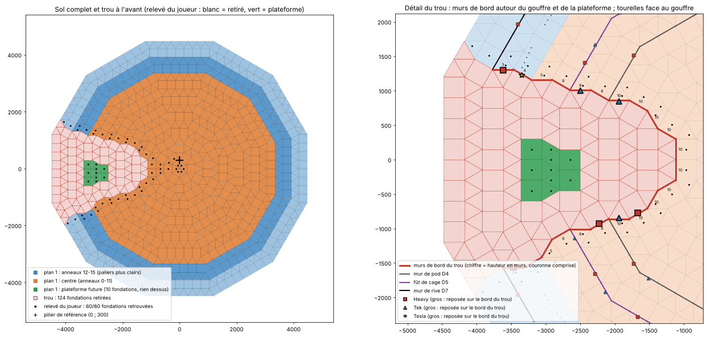

# Forteresse circulaire Ø30 sur Metal Cliff Platform — Notice de montage

Base PvP circulaire de 30 fondations pour **ARK: Survival Ascended**, posée sur une Metal Cliff Platform au sommet d'un piton rocheux en pleine mer.

Le centre est repris à zéro, sans le Coeur Base. À l'avant de la plateforme, un **trou** (gouffre) entame la base : la construction est adaptée à votre relevé (module 06). Le dossier contient :
- un plan par module ;
- les templates **Template Hammer** (format JSON des exports Wikily.gg), en **8 plans** par zone ;
- les coordonnées de chaque pièce (CSV) ;
- le bilan matériaux complet ;
- le générateur Python qui produit tout cela.

| Module | Document | Ce qu'il couvre |
|---|---|---|
| 01 | [01_Sol_Fondations_Decaissement.md](01_Sol_Fondations_Decaissement.md) | Calpinage carrés + triangles en étoile, Ø30, **bord abaissé en 2 paliers** (Ø26 → −150, Ø28 → −300), fondations du trou |
| 02 | [02_Pod_Central_Atelier.md](02_Pod_Central_Atelier.md) | Pod Ø15, colonne d'escaliers, piliers porteurs, hall, emplacements des machines, plancher de toit et **toit en rampes inclinées** (tours 1201/1809) |
| 03 | [03_Rampe_Glisse_Overhang.md](03_Rampe_Glisse_Overhang.md) | Mur de rive, colonnade circulaire de piliers côte à côte (1 rang), **rampes de glisse** (pente A et overhang en rampes inclinées), mur de jupe, ligne de pics |
| 04 | [04_Tourelles_DoubleDoorframes.md](04_Tourelles_DoubleDoorframes.md) | Cage : L1 = tourelles verticales, L2 = double doorframes, casquette anti-accroche |
| 05 | [05_Defense_Cap_Repartition.md](05_Defense_Cap_Repartition.md) | Cap 100 (Heavy + Tek, Tesla en plus), 110 tourelles, ordre de pose, couverture, câblage |
| **06** | [06_Plans_et_Trou.md](06_Plans_et_Trou.md) | **Trou à l'avant** (124 fondations retirées, murs de bord, casquette du trou, tourelles face au gouffre), **plateforme verte** et **8 plans** |
| **07** | [07_Bilan_Materiaux.md](07_Bilan_Materiaux.md) | **Bilan matériaux complet**, équipements compris : réplicateur, forge à vapeur, labo de fortune, 20 stockages dédiés, 20 coffres-forts, 2 générateurs Tek |
| **09** | [09_Audit_Limites_Moteur.md](09_Audit_Limites_Moteur.md) | **Audit des limites moteur** : 8 400 structures, 100 tourelles, plafonds à 2 cases d'un appui au sol, 70 murs de haut ; bilan avant / après |
| **08** | [08_Revue_Constructibilite.md](08_Revue_Constructibilite.md) | **Revue de constructibilité** : comparaison avec vos templates, appuis des rampes, murs de chaume à démolir, contrôle des collisions |



---

## 1. Ce qu'il faut retenir

1. **8 plans par zone** (module 06) : sol des anneaux 12 à 15 ; murs, rampes et tourelles des anneaux 12 à 15 ; sol du centre ; pod ; cage ; toit ; tourelles de la cage ; plateforme verte. Chaque plan porte le pilier de référence. Les outils de production et de stockage ne font partie d'aucun template.
2. **Le trou à l'avant** (θ 180°) suit votre image annotée :
   - **124 fondations retirées** (en blanc), du pod (anneau 4) jusqu'au bord ;
   - **10 fondations de plateforme** (en vert) posées au milieu du trou, sans rien dessus, pour un projet futur ;
   - la base est fermée sur le bord du gouffre par **136 murs de bord**, de toute la hauteur, avec une **casquette en rampes** au-dessus du gouffre ;
   - votre export *trou* (60 fondations) retombe à 60/60 sur l'étoile, autour de votre pilier de référence.
3. **110 tourelles : les 100 places du cap** (65 Heavy, 35 Tek) **et les 10 Tesla**, qui ne comptent pas. Les 12 emplacements tombés dans le trou sont reposés sur les murs de bord, face au gouffre, et 10 tourelles debout sous le toit couvrent le dessus du centre. Il reste en réserve 15 Heavy (module 09).
4. **L'étoile existante est reproduite à l'identique** : les anneaux 1 à 7 retombent pièce pour pièce sur le template SkunkHD 481, moins les 27 pièces du trou.
5. **Les tourelles sont verticales**, comme dans le template *Straight Heavy* (2727) et la tour 1809 :
   - elles sont posées sur un mur de chaume de pose ;
   - **vous démolissez les 100 murs de chaume en jeu** (liste : `donnees/08_chaume_a_demolir.csv`).
6. **Aucun toit incliné : des rampes partout.** Sur un toit à 45°, on tient debout ; sur des rampes inclinées (Sloped Railing), rien ne tient et tout glisse. Le toit, la casquette, la pente A, l'overhang et le débord sont donc faits de **892 rampes inclinées** en lignes de lames, comme sur les tours 1201 et 1809.
   - **Chaque ligne de lames est tenue comme sur les tours** : elle part d'un appui (haut de mur, bord de plancher, poutre fine). Elle monte ensuite librement de 6 lames au plus, ou pend d'une seule lame.
   - Il y a 104 poteaux en piliers fins et 94 poutres fines.
   - Option `--appuis prudent` : un poteau sous le bout de chaque ligne montante (200 poteaux).
   - **Aucune pièce n'en traverse une autre.** Le générateur contrôle les collisions et les appuis à chaque régénération (module 08).
7. **Coût.** Il reste à fabriquer, hors tourelles (déjà en inventaire), ≈ **136 700 lingots de métal** et **34 200 pâte cimentée**, équipements compris. S'y ajoutent cristal, élément, perles noires, polymère et huile pour les équipements (module 07).
8. **Bord abaissé deux fois** : l'anneau 14 (Ø26 → Ø28) est à −150, l'anneau 15 (Ø28 → Ø30) à −300.
9. Sol, murs, plafonds, piliers PA/PB et cadres se posent en vanilla. Les rampes inclinées et leurs poteaux, la colonnade, la plateforme verte isolée et les pièces dans le vide (débord, jupe, casquette du trou) exigent **Template Hammer**.

## 2. Conventions (relevées dans les templates fournis)

| Grandeur | Valeur | Origine |
|---|---|---|
| Fondation | 300 × 300 UU ; triangle de côté 300, hauteur 259,81 | Floor_Metal / BP_TriFoundation_Metal |
| Niveau (mur) | 300 UU | Wall_Metal |
| Repère | origine = centre de l'étoile ; θ = atan2(y, x) = yaw Unreal ; axe 0° = première branche de carrés ; le trou est à θ 180° | template 481, votre relevé du trou |
| Cote plan **Z** | 0 = dessus des fondations intérieures | — |
| z template | fondation Z + 40 · mur, cadre Z_bas + 240 · plafond Z + 90 · pilier Z_bas + 240 | templates 1201, 1087, mho |
| Triangle | pivot à mi-hauteur, yaw = base → pointe (aussi valable à ± 120°) | contrôle 481 : 282/282 |
| Rampe inclinée (StructureBP_Railing_Sloped_Metal) | lignes de lames au pas de 300 ; +300 UU en hauteur par pas de 300 UU ; pivot au milieu de la rampe, z template = Z du bas + 290 ; yaw = θ du côté − 90° ; seule pièce de pente de la base | tours 1201, 1809 |
| Appui d'une ligne de rampes | part d'un haut de mur, d'un bord de plancher ou d'une poutre fine ; au plus 6 lames libres au-dessus du dernier appui, au plus 7 entre deux appuis, 1 seule en porte-à-faux qui pend ; poteau = piliers fins (Pillar_Thin_Metal, 300 UU, z template = Z_bas + 240) | tours 1809 (poutres d'égout, poteaux de faîtage, 6 lames libres) et 1201 (lame de rive) |
| Tourelle verticale | mur de chaume dans l'emplacement ; pivot 10 UU devant, à mi-hauteur ; Heavy/Tek : pitch −89,5°, yaw θ_tir + 90°, roll −90° ; Tesla : pitch 0°, yaw θ_tir + 90°, roll −90° | templates 2727, 1809 (la tour 1201 fixe ses tourelles dans des cadres doubles, sans chaume) |
| Pilier « large » | Pillar_Metal, largeur prise à 39,3 UU (1 pilier / 1 vide) | template 704 |

### Contours de référence : dodécagones D(n)

| Contour | Rôle | Apothème (UU) | Rayon des coins | Ø entre plats (fondations) | Pièces par côté |
|---|---|---|---|---|---|
| D1 / D2 | coins = piliers PB / PA | 559,8 / 1 119,6 | 579,6 / 1 159,1 | 3,73 / 7,46 | 1 / 2 |
| **D4** | mur du pod (= étoile 481) | 2 239,2 | 2 318,2 | 14,93 | 4 |
| **D5** | cage | 2 799,0 | 2 897,8 | 18,66 | 5 |
| *cercle* | colonnade | rayon 3 600 | — | 24,0 | 288 positions |
| **D7** | mur de rive | 3 918,7 | 4 056,9 | 26,12 | 7 |
| **D8** | bord de la plateforme | 4 478,5 | 4 636,4 | 29,86 | 8 |

## 3. Contenu du dépôt

| Chemin | Contenu |
|---|---|
| `templates/phases/Phase_1…3_*.json` | **Les 3 phases de pose** (moins de 2 000 entrées chacune), du bas vers le haut : à poser dans l'ordre |
| `templates/plans/Plan_1_sol_anneaux_12-15.json` | Sol des anneaux 12 à 15 (paliers compris), avec la pile d'ancrage |
| `templates/plans/Plan_2_murs_rampes_tourelles_anneaux_12-15.json` | Rive, bord du trou extérieur, colonnade, jupe, appuis, pente A, overhang et débord, tourelles extérieures |
| `templates/plans/Plan_3_sol_centre_anneaux_0-11.json` | Sol du centre (hexagone et anneaux 1 à 11) |
| `templates/plans/Plan_4_pod_central.json` | Pod : mur de pod, bord du trou, piliers, escaliers, mezzanine |
| `templates/plans/Plan_5_cage_et_casquette.json` | Fût, bord du trou dans le couloir, galeries, L2, casquette |
| `templates/plans/Plan_6_toit_rampes.json` | Plancher de toit, poteaux, toit en rampes, casquette du trou |
| `templates/plans/Plan_7_tourelles_cage_L1.json` | 60 paires mur de chaume + tourelle de la cage et du bord du trou |
| `templates/plans/Plan_8_plateforme_future_anneaux_9-11.json` | Plateforme verte : 10 fondations, rien dessus |
| `references/Trou_points_ancrage.json` | Votre export *trou* (60 fondations + pilier de référence), qui sert au recalage |
| `references/Trou_fondations.json` | Fondations du trou relevées sur votre image : `retirees` (blanc), `plateforme` (vert) |
| `donnees/Plan_*.csv` | Toutes les pièces de chaque plan, avec leur phase |
| `donnees/06_bord_du_trou.csv` | Murs de bord du trou : position, sens, hauteur |
| `donnees/05_matrice_tourelles.csv` | Les 110 tourelles : ordre, type, couche, chaume, tourelle, sens de tir |
| `donnees/08_chaume_a_demolir.csv` | Les 100 murs de chaume à démolir : plan, n° d'entrée, tourelle portée, ce qui est posé au-dessus |
| `templates/test/Secteur_test_theta_-15_45.json` | Essai en solo : un secteur de 60° de tous les plans (module 08 §6) |
| `donnees/07_equipements.csv` | Positions des équipements, hors plan |
| `donnees/03_colonnade.csv`, `donnees/03_ligne_pics.csv`, `donnees/synthese.json` | Colonnade, pics, toutes les cotes et tous les bilans |
| `plans/*.png` | Trou et plans, calpinage, coupe radiale, pod, plan des rampes, tourelles et câblage |
| `outils/forteresse.py` | Générateur (Python 3) |

## 4. Pré-requis

- Mod **Template Hammer**. Testez d'abord en solo, avec la même plateforme.
- **Pile d'ancrage en (0 ; 300)**, au sommet de l'hexagone central situé à θ 90°. C'est votre **pilier de référence**, celui de votre export *trou*.
  - La phase 1 (ou `Plan_1`) pose 2 demi-piliers empilés (`snapOverrides [0,1]`).
  - Tous les autres plans portent 1 demi-pilier qui se pose sur cette pile (`snapOverrides [0]`).
  - Démolissez la pile à la fin.
- **Orientation** : l'axe 0° des templates correspond à la branche de carrés orientée vers la droite sur `plans/plan_calpinage.png`, à l'opposé du trou. Votre export *trou* est tourné de −150° par rapport à ce repère (module 06 §1).
- **Réglages serveur** : `LimitTurretsNum`, `LimitTurretsRange`, limite de structures. La base compte 4 966 structures en tout (dont 110 tourelles, 74 pics et 45 équipements), 5 075 au plus fort du chantier : plafond retenu de 8 400 (module 09).
- **Étoile déjà construite** : dans le plan 3, sautez les pièces déjà en place et retirez de votre étoile les 27 pièces qui tombent dans le trou (anneaux 4 à 7, côté θ 180° ; `donnees/synthese.json` → `trou`).

## 5. Séquence de pose : 3 phases, du bas vers le haut

**Posez les 3 phases de `templates/phases/`, dans l'ordre.** Chacune a moins de 2 000 entrées, la limite de Template Hammer.

- **Une seule règle** : chaque pièce est posée après ce qui la porte.
  - le sol avant les murs, et le mur du dessous avant celui du dessus ;
  - le mur ou le pilier avant le plafond qui repose dessus ;
  - l'appui avant la rampe ;
  - le mur de chaume avant sa tourelle.
- Le générateur déduit ces appuis de la géométrie (`porteurs()`) et vérifie qu'aucune pièce ne passe avant son porteur, ni dans la même phase ni d'une phase à l'autre. Une pièce suspendue (niveau bas de la jupe, chaume sous la jupe) vient juste après la pièce à laquelle elle pend.

| Phase | Fichier | Hauteur | Contenu | Entrées |
|---|---|---|---|---|
| **1** | `Phase_1_sol_et_dessous.json` | sous Z0 | toutes les fondations (paliers et plateforme verte compris), pile d'ancrage ; sous le bord : 83 pieds de poteaux de l'overhang, mur de jupe (166), 94 poutres et 188 rampes du débord, 26 murs de chaume + 26 Heavy de jupe | 1 613 |
| **2** | `Phase_2_du_sol_a_la_mezzanine.json` | Z0 → 1800 | murs du pod et du fût, murs de bord du trou, rive, colonnade, piliers PA et PB (du sol), escaliers, haut des poteaux de l'overhang, pente A et overhang (376 rampes), 14 murs de chaume + 10 Tesla + 4 Heavy (rive et bord du trou) | 1 688 |
| **3** | `Phase_3_de_la_mezzanine_au_faitage.json` | Z1800 → 5100 | mezzanine, galeries, 60 murs de chaume + 60 tourelles de L1, cadres L2, murs du haut du pod et du bord du trou, haut des piliers PA et PB, plancher de toit Z2400, 10 tourelles debout, poteaux et toit en rampes, casquettes | 1 650 |

- **Ancrage** : la phase 1 pose la pile d'ancrage sur votre pilier de référence en (0 ; 300). Les phases 2 et 3 portent un demi-pilier qui se pose dessus.
- **Démolition du chaume** : démolissez les murs de chaume **à la fin**, une fois les 3 phases posées (`donnees/08_chaume_a_demolir.csv`). Au-dessus des murs de chaume de L1 et du bord du trou sont posés des cadres et des murs.
- **Contenu** : les 3 phases contiennent exactement les mêmes pièces que les 8 plans par zone de `templates/plans/`. Ceux-ci restent disponibles pour reprendre une zone, mais ne les posez pas en plus des phases.

### Finitions

1. **Démolissez les 100 murs de chaume** (`donnees/08_chaume_a_demolir.csv` : plan 2 → 40, plan 7 → 60). Testez d'abord sur une tourelle qu'elle reste en place, avec ce qui est posé au-dessus. Rien d'autre n'est en chaume dans les plans.
2. Posez les 74 Metal Spike Walls (`donnees/03_ligne_pics.csv`).
3. Posez les portes doubles : 6 au sol du pod, 6 au sol du fût, 11 accès galerie, cadres de L2. Ajoutez les échelles sous les 5 trappes.
4. Posez les équipements aux emplacements prévus (module 07 §3) et le câblage (module 05 §8).
5. Démolissez la pile d'ancrage.

## 6. Bilan matériaux (détail : module 07)

| Poste | Lingots | Pâte | Autres |
|---|---|---|---|
| Structure des 8 plans (4 737 pièces, dont 104 poteaux et 94 poutres d'appui des rampes) | 110 412 | 31 761 | — |
| Ancres (9 demi-piliers, temporaires) | 117 | 36 | — |
| 74 murs de pics | 1 850 | — | 1 480 cuir, 2 220 fibre |
| 100 murs de chaume (gabarits) | — | — | ~700 chaume, ~400 fibre, ~400 bois |
| Équipements : 1 réplicateur, 1 forge à vapeur, 1 labo de fortune, 20 stockages dédiés, 20 coffres-forts, 2 générateurs Tek | 26 000 | 2 900 | 220 élément, 3 350 cristal, 470 perles noires, 5 850 polymère, 220 électroniques, 100 poudre étincelante, 1 400 huile |
| **Total à fabriquer** | **138 379** | **34 697** | — |
| *Tourelles (65 H, 35 T, 10 S), en inventaire* | *43 600* | *14 750* | *22 050 électroniques, 9 300 polymère, 2 000 cristal, 105 élément* |

Équivalent brut (hors tourelles) : ≈ 277 000 minerai de métal, ≈ 186 000 chitine ou kératine, ≈ 371 000 pierre.

Avec `--appuis prudent` : 145 737 lingots et 36 961 pâte, en 4 phases de pose.

Si votre étoile (anneaux 1 à 7) est déjà construite, retirez encore 87 fondations et 174 triangles : 8 700 lingots et 2 697 pâte.

## 7. Points à valider en jeu (solo / serveur de test)

| # | Point | Repli |
|---|---|---|
| 1 | La tourelle reste en place quand on démolit son mur de chaume | Laisser le chaume, ou un mur métal derrière la tourelle |
| 2 | Un plan posé d'un bloc ne se fait pas refuser de pièces faute d'appui | Poser d'abord le plan qui porte l'appui (module 06 §5) |
| 3 | Un mur de chaume s'accroche sous le mur de jupe, et le niveau bas de la jupe sous le bord de l'anneau 15 | Template Hammer |
| 4 | Largeur réelle du pilier métal (colonnade 1 pilier / 1 vide) | Ajuster `largeur_pilier` et régénérer |
| 5 | Emprise du trou : chaque fondation blanche est bien au-dessus du vide, chaque fondation gardée est posable | Corriger `references/Trou_fondations.json` et régénérer |
| 6 | La plateforme verte, isolée au milieu du trou, se pose en Template Hammer | La relier par une fondation, ou la poser plus tard |
| 7 | Les lames de la casquette du trou s'accrochent en haut des murs de bord | Les retirer : ce qui glisse tombe quand même dans le trou |
| 7 bis | Template Hammer pose une pièce qui en touche une autre au snap (le contrôle de collisions tolère ces contacts) ; une ligne de 6 lames tient libre au-dessus de son appui | Module 08 §6 : `templates/test/Secteur_test_theta_-15_45.json` ; repli `--appuis prudent` |
| 8 | Diamètre utile de la plateforme (les 12 pointes de D8 vont à 4 636 UU) | Laisser vides les triangles de pointe de l'anneau 15 |
| 9 | Paliers −150 et −300 posables | `--decaissement 0` |
| 10 | `snapOverrides` de Template Hammer | Placement libre sur la pile (0 ; 300) |
| 11 | Metal Spike Wall sur fondation | Bord de plateforme, sous l'overhang |
| 12 | Portée du générateur Tek n°2 ≥ 3 800 UU (les 30 Tek) ; alimentation de la jupe et des Tesla | Rapprocher le générateur, ajouter câbles et générateur électrique |
| 13 | Sous-face de la plateforme au-dessus de Z −600 | Jupe plus basse |
| 14 | Coût du coffre-fort (une seule source) et des pièces marquées ~ | Vérifier à l'établi |
| 15 | Hauteur des rampes inclinées par rapport à leurs appuis (décalage relevé sur les tours 1201 et 1809) | Corriger `+ 200` dans `pente()` et `bouts_lame()` |
| 16 | Un joueur ne tient pas debout sur une lame de rampes, et glisse | Lames plus serrées (pas de 150) |

## 8. Régénérer ou adapter

```bash
python3 outils/forteresse.py                        # défaut : débord 2, casquette 1, paliers de 150, colonnade r=3600
python3 outils/forteresse.py --trou autre.json      # autre relevé du trou (listes retirees / plateforme)
python3 outils/forteresse.py --colonnade 2560       # colonnade dans le couloir, sous la galerie
python3 outils/forteresse.py --debord 1             # débord d'une seule rampe dans le vide (jupe gardée)
python3 outils/forteresse.py --casquette 2          # casquette plus longue (un poteau de 6 piliers fins par ligne)
python3 outils/forteresse.py --appuis prudent       # un poteau sous le bout de chaque ligne de rampes montante
python3 outils/forteresse.py --decaissement 300     # paliers d'un mur complet (−300 puis −600)
python3 outils/forteresse.py --verifier-481 chemin/template-481-building-0.json
```

Les autres paramètres (inventaire, cap, colonnade, emplacements des équipements, générateurs) sont en tête du script : `P`, `GABARITS`, `GENERATEURS`. Le découpage en plans est dans `PLANS`.

À chaque régénération, le script refuse d'écrire des plans qui ne passent pas ses contrôles (modules 08 et 09) :
- aucune pièce au-dessus du trou ;
- aucune collision entre pièces ;
- chaque rampe tenue par ses appuis ;
- au plus 8 400 structures, 100 tourelles comptées, 70 murs de haut ;
- aucun plafond à plus de 2 cases d'un appui relié au sol.

## 9. Sources

Templates fournis (zip *Construction ARK*), utilisés ainsi :
- **trou** (le vôtre) et votre image annotée : emprise du trou, plateforme verte, pilier de référence ;
- **481** (SkunkHD) : étoile de référence ;
- **2901 / 2902 / 2903** (mho) : rayons et ancre ;
- **704 / 701** (WUAN) : cercles de piliers et colonnade ;
- **2727**, **1809**, **1201** : tourelles verticales sur chaume (2727, 1809 ; la 1201 les fixe dans des cadres doubles), Tesla latérales ; **toit en rampes inclinées** (1201, 1809) et **leurs appuis** : poutres fines d'égout, poteaux de faîtage en piliers fins, une seule lame en porte-à-faux (module 08) ;
- **1087** : double doorframes ;
- **2552** : repère des pièces de toit (plus utilisées : aucun toit incliné).

Sources web :
- [ark.wiki.gg — Heavy Auto Turret](https://ark.wiki.gg/wiki/Heavy_Auto_Turret), [Tek Turret](https://ark.wiki.gg/wiki/Tek_Turret), [Turret](https://ark.wiki.gg/wiki/Turret), [Tesla Coil](https://ark.wiki.gg/wiki/Tesla_Coil), [Steam Forge](https://ark.wiki.gg/wiki/Steam_Forge), [Makeshift Megalab](https://ark.wiki.gg/wiki/Makeshift_Megalab), [Tek Generator](https://ark.wiki.gg/wiki/Tek_Generator), [Tek Replicator](https://ark.wiki.gg/wiki/Tek_Replicator), [Tek Dedicated Storage](https://ark.wiki.gg/wiki/Tek_Dedicated_Storage)
- [wikily.gg — Heavy Auto Turret](https://wikily.gg/ark-survival-ascended/items/heavy-auto-turret/), [Tek Turret](https://wikily.gg/ark-survival-ascended/items/tek-turret/), [Tesla Coil](https://wikily.gg/ark-survival-ascended/items/tesla-coil/), [Metal Foundation](https://wikily.gg/ark-survival-ascended/items/metal-foundation/), [Metal Pillar](https://wikily.gg/ark-survival-ascended/items/metal-pillar/), [Sloped Metal Roof](https://wikily.gg/ark-survival-ascended/items/sloped-metal-roof/), [Metal Spike Wall](https://wikily.gg/ark-survival-ascended/items/metal-spike-wall/), [Steam Forge](https://wikily.gg/ark-survival-ascended/items/steam-forge/), [Makeshift Megalab](https://wikily.gg/ark-survival-ascended/items/makeshift-megalab/), [Tek Replicator](https://wikily.gg/ark-survival-ascended/items/tek-replicator/), [Tek Dedicated Storage](https://wikily.gg/ark-survival-ascended/items/tek-dedicated-storage/)
- [dododex — Tesla Coil](https://www.dododex.com/item/2165/tesla-coil), [Metal Triangle Foundation](https://www.dododex.com/item/1492/metal-triangle-foundation), [Metal Spike Wall](https://www.dododex.com/item/1486/metal-spike-wall), [Steam Forge](https://www.dododex.com/item/2168/steam-forge), [Makeshift Megalab](https://www.dododex.com/item/2137/makeshift-megalab), [Tek Replicator](https://www.dododex.com/item/1840/tek-replicator), [Tek Dedicated Storage](https://www.dododex.com/item/1808/tek-dedicated-storage)
- [dododex — Metal Railing](https://www.dododex.com/item/1482/metal-railing), [ark.wiki.gg — Metal Railing](https://ark.wiki.gg/wiki/Metal_Railing) (coût repris pour la rampe inclinée)
- [ark-unity — Metal Ceiling](https://ark-unity.com/ark-survival-ascended/items/metal-ceiling-hatchframe/), [ase.gg — Metal Wall](https://ase.gg/items/metal-wall), [Sportskeeda — Vault](https://www.sportskeeda.com/mmo/all-storage-structures-ark-survival-ascended-craft)
- [mp1st — turret limit](https://mp1st.com/news/ark-update-now-live-on-pc-adding-heavy-turret-doubled-tek-turret-damage), [GINX — Tesla Coil](https://www.ginx.tv/en/aberration-tesla-coil-turrets), [GINX — Tek Generator](https://www.ginx.tv/en/tek-generator-craft-uses)
